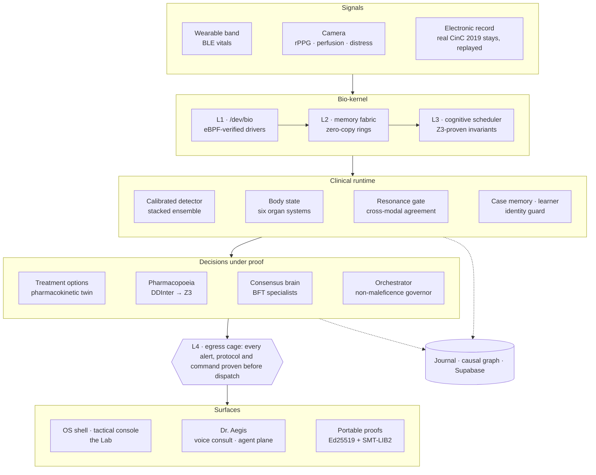
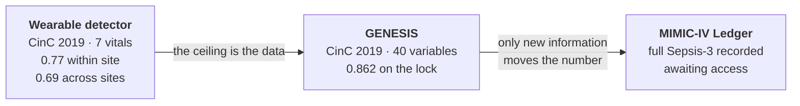
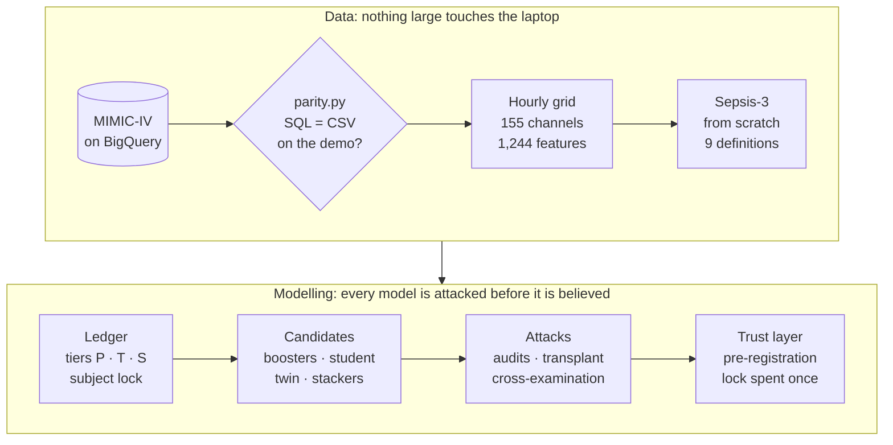

<div align="center">

# AegisOS

**An operating system for sepsis in critical care, and the research program that measured, honestly, how far it can see.**

[](https://github.com/Arnavnemade1/Sepsis/actions/workflows/verify-os.yml)


[Findings](#the-findings) · [Architecture](#architecture) · [Research lines](#the-three-research-lines) · [MIMIC-IV](#mimic-iv-the-next-chapter) · [Verification](#how-a-claim-gets-in) · [Quickstart](#quickstart) · [Docs](#documentation)

</div>

---

AegisOS turns continuous bedside signals (a wearable band, a plain camera, the electronic
record) into a live model of one patient. That model has three outputs: a calibrated sepsis
risk, an organ-by-organ body state, and treatment options that each carry a formal proof of
safety. It is built as an operating system, with a kernel, schedulers, drivers, users, a
filesystem and a shell. An ICU is a real-time, multi-tenant, safety-critical system, and it
deserves to be engineered like one.

Around the runtime sits a research program with one rule: **no number ships without the
dataset, the metric and the adversarial check that earned it.** It has published more nulls
than wins. The nulls are why the wins can be believed.

> [!IMPORTANT]
> Research and educational use only. AegisOS is not a medical device and must not be used
> for clinical decisions.

## At a glance

| | Where it stands |
|:--|:--|
| **Shipped detector** | A stacked ensemble trained on the patient label. Its members are two histogram boosters, extra-trees, logistic regression and a utility-aimed XGBoost. On held-out CinC 2019 patients: **AUROC 0.767, ECE 0.001** |
| **At the bedside** | At the deployed threshold it flags **62%** of septic patients and **32%** of non-septic patients at least once. The alarm burden, not the AUROC, is the product's real bottleneck |
| **Across hospitals** | **AUROC 0.68–0.70**, trained at one hospital and scored at the other. This is the honest deployment number |
| **The CinC 2019 ceiling** | With all 40 variables: **0.862** on a locked test set, scored once (**0.816** once the ICU clock is removed). The learning curve's asymptote is **0.887** |
| **MIMIC-IV** | Built end to end and verified on the open demo by **103 checks**, with every harness mechanism mutation-tested. The full run starts when credentialed access arrives |
| **Scale** | **1,000 beds** inside a 600 ms tick at p99 (p99 267 ms), on one laptop core, on real patients. Every scheduling decision is Z3-proven |
| **Verification** | **89 suites**. The ones behind published claims plant known failures and require the guard to fire |

---

## The findings

These are the twelve most important results, strongest first. Each links to the report
that holds the method, the numbers and the caveats.

### 1 · The first detector was an illusion

The original hand-tuned detector was finally measured on real ICU patients. It scored
**AUROC ≈ 0.64**, and its probabilities were essentially uncalibrated. Its perfect demo had
come from tuning the simulator and the detector together. Every detector since has been
trained and validated on real labelled patients, with patient-grouped splits.
→ [`backend/ml/README.md`](backend/ml/README.md)

### 2 · The ceiling is the data, not the architecture

No new architecture or representation raised discrimination on hourly vitals:
- richer temporal features;
- a causal MiniRocket;
- Forest-VSA;
- quantum HDC;
- a dilated TCN and a Mamba-2 state-space model.

A recursive hyperparameter search over the wearable ensemble accepted **0 of 16** mutations.
The one thing that moved the number was information. A properly regularised booster reading
all 40 CinC variables took the locked test set from **0.805 to 0.862** (+0.057, CI +0.046 to
+0.068). The purpose-built GENESIS architecture beat a tuned booster on the development
folds, then **failed to replicate on the lock**. The simpler model is the recommendation.
→ [`docs/GENESIS.md`](docs/GENESIS.md) · [`docs/FRONTIER_REPORT.md`](docs/FRONTIER_REPORT.md)

### 3 · About 0.05 of every CinC 2019 AUROC is a clock

Never-septic records stop near 60 hours, while septic records run to 336. So the ICU clock
**alone** scores **0.636**. Every GENESIS number is therefore paired with an
*hour-matched* AUROC, under which the clock is worth exactly 0.500.

The learning curve's asymptote, **0.887**, puts 0.90 out of reach on CinC with this label.
Sepsis-3 has two halves, and the half that sets the onset clock (cultures and antibiotics)
is not in CinC at all. That is why the next step is MIMIC-IV.
→ [`docs/GENESIS.md`](docs/GENESIS.md)

### 4 · On hourly vitals, sepsis detection is patient classification, not event timing

Pooled AUROC averages two questions:
- *Which patients* become septic?
- *Which hours* of a septic stay come before onset?

The experiment labelled every hour of a septic stay positive during training. That raised
detection at a 5% alarm budget by **48%** (0.274 → 0.406). The gain was significant in
**25 of 25** density × budget cells, and it transferred across hospitals in both directions.

Scattering the extra positives at **random** beat placing them before onset, and AUROC did
not move. This lever was invisible to a project that had been reading AUROC.
→ [`docs/SUPERVISION_DENSITY.md`](docs/SUPERVISION_DENSITY.md)

### 5 · Median lead time does not measure early warning

A random score produced the same median lead time as the shipped detector at every matched
detection rate. That retracted every lead time this project had published (26 to 40 hours).
The replacement costs nothing: report lead time against a shuffled-score null at a matched
detection rate. → [`docs/LEAD_TIME_NULL.md`](docs/LEAD_TIME_NULL.md)

### 6 · We trained on the wrong target, and stacking pays for disagreement

The challenge label turns positive 6 hours before onset, but the official utility also pays
for alarms 6–12 hours earlier. So **3,419 patient-hours**, carrying ~19% of the
positive-side utility, had been trained as negatives.

Re-aiming every ensemble member at the utility was worth nothing: the re-aimed ensemble
ranked hours almost exactly as the original did (rank correlation 0.965). What did pay was one utility-aimed XGBoost that *disagrees* with the stack (rank correlation
0.679): it raised AUPRC by **9.4%**. → [`docs/FRONTIER_REPORT.md`](docs/FRONTIER_REPORT.md)

### 7 · The alarm threshold was a guess, and it sat on a cliff

The shipped threshold, 0.12, was a constant nobody had derived. It sat at the **98.3rd
percentile** of the detector's own output, where a small calibration drift would have
silently switched the alarm off. Deriving the threshold from out-of-fold predictions bought
**+14% utility and +10 points of detection** at an identical AUROC. When discrimination is at
its ceiling, the wins are in decisions. → [`backend/ml/README.md`](backend/ml/README.md)

### 8 · Cross-hospital "decision collapse" was our own bug, and label-free adaptation makes it worse

Across hospitals, utility fell 54% while AUROC fell 13%. Much of that gap was
threshold/fit coupling, not hospital shift.

Label-free prior correction made things significantly worse in both directions. EM
estimated a **29×** prevalence shift against a true **1.99×**. The two hospitals differ in
their patients' measurements (a domain classifier separates them at AUC 0.90), not in their
label rates. → [`docs/TRANSFER.md`](docs/TRANSFER.md)

### 9 · Uncertainty guarantees do not travel

Within a hospital, conformal abstention delivers **93.5%** coverage at 94% requested. Now
calibrate it at one hospital and serve it at the other: septic-hour coverage collapses from
**0.929 to 0.739**, while the layer *halves* its abstention rate. It grows confident exactly
where it should not. → [`docs/CONFORMAL.md`](docs/CONFORMAL.md)

### 10 · One threshold is not one burden

Discrimination is flat across age and sex, but the alarm burden is not. At the deployed
threshold:
- patients over 80 absorb **+6.3 points** more false alarms than under-45s;
- men absorb **+4.9** more than women.

Both gaps survive Bonferroni correction. Per-group thresholds were refused: they would
launder the disparity into the threshold rather than fix it.
→ [`docs/SUBGROUP_AUDIT.md`](docs/SUBGROUP_AUDIT.md)

### 11 · The MIMIC-IV harness caught leaks in our own pipeline before any data arrived

On the open demo it found three:
- **Two covert channels.** Verbal GCS predicts mechanical ventilation at AUROC **0.962**,
  because the intubation recode turns a score of 0 into a record of the breathing tube. FiO2,
  a ventilator setting, predicts it at **0.949**.
- **A counterfactual design that smuggled the care schedule back in.** A schedule-only world
  scored **0.731** "from values". With state-matched successors it falls to **0.542**.
- **A standard cross-fitting recipe for distillation that leaks labels through the
  teacher.** It produced **+0.048** of apparent gain.

All three are fixed and guarded by checks that were seen to fail.
→ [`docs/MIMIC.md`](docs/MIMIC.md)

### 12 · 1,000 beds on one core, by removing work rather than adding hardware

The load harness drives the real cohort tick with no mocks: device bus, memory fabric,
fusion, learner, HDC memory, resonance gate and the Z3-verified scheduler. It first held
**250 beds** inside the 600 ms tick; profiling showed Z3 was not the bottleneck, as planned
for, and that hyperdimensional memory was. A second pass found that 88% of each tick
recomputed an unchanged hourly input, and that every bed's clock was phase-locked, so the
whole ward recomputed on the same tick. Exact memoisation, staggered clocks, a lookup-table
encoder and a one-script scheduler proof now hold **1,000 beds at p99 267 ms**
(400 beds: 664 → 106 ms). Every change is bit-identical to the code it replaced, held there
by a suite of 17 checks that must catch planted defects. → [`docs/SCALE.md`](docs/SCALE.md)

### Published nulls

A null reported in full is a result. These are the hypotheses this project tested and lost.

| Hypothesis | What happened | Report |
|:--|:--|:--|
| The *speed* of autonomic recovery (τ) predicts circulatory decompensation | Failed its pre-registered bar. Retested on VitalDB at 6× the cohort with the intervention confound removed, with the same answer | [RECOVERY_NULL](docs/RECOVERY_NULL.md) |
| Blood gene expression separates infection from sterile inflammation across cohorts and platforms | Mean transfer AUROC 0.727 (CI 0.636–0.810) against a 0.75 bar. **Bar missed**, scored once against a committed pre-registration | [HOST_RESPONSE_NULL](docs/HOST_RESPONSE_NULL.md) |
| Organ-system uncoupling carries sepsis signal at hourly resolution | Falsified with a matched-pair surrogate design | [SUPERVISION_DENSITY](docs/SUPERVISION_DENSITY.md) |
| A patient-supervised TCN added to the stack helps | Refused: its significant AUROC gain (+0.0038) came with lower detection at the alarm budget that matters | [SEQUENCE_PATIENT_NULL](docs/SEQUENCE_PATIENT_NULL.md) |
| Quantum hyperdimensional computing beats classical models on tabular vitals | No. The encoded states concentrate, and the quantum kernel cannot discriminate | [backend/ml](backend/ml/README.md) |
| Random-convolution or tree-topology representations add signal | MiniRocket +0.0012 (n.s.). Forest-VSA's own lossless ceiling loses to its donor | [backend/ml](backend/ml/README.md) |
| A new hospital can re-derive its operating point without labels | Significantly harmful in both directions | [TRANSFER](docs/TRANSFER.md) |
| Median lead time is evidence of early warning | Retracted | [LEAD_TIME_NULL](docs/LEAD_TIME_NULL.md) |

---

## Architecture



One tick moves top to bottom:
1. Drivers publish into ring buffers in a zero-copy memory fabric.
2. A scheduler, whose invariants are proven in Z3, decides which beds get compute first.
3. The clinical runtime turns each bed's window into a risk, a body state and the evidence
   behind them.
4. Candidate actions are checked against pharmacology and hospital policy.
5. No alert, protocol, actuator command or automated note is dispatched until Z3 has proven
   it against the medical invariants. A failed proof quarantines the output.

Everything that happens is appended to a tamper-evident journal.

<details>
<summary><b>The bio-kernel</b> · <code>backend/aegis/kernel/</code></summary>

<br/>

| Layer | Modules | What it is |
|:--|:--|:--|
| **L1 · Devices** | `devbio.py` `ebpf.py` `ebpfdrv.py` `runtime.py` `supervisor.py` | `/dev/bio` is one driver architecture for every sensor. Untrusted drivers pass a static verifier (termination, memory safety, capabilities) before they run, and a supervisor isolates a faulting driver under live load |
| **L2 · Memory** | `memfabric.py` | A zero-copy virtual memory fabric of per-signal ring buffers |
| **L3 · Scheduling** | `scheduler.py` `hdsched.py` `hdkernel.py` | A multi-tenant cognitive scheduler with Z3-proven invariants that folds critical-slowing-down foresight into bed priority. HDSched is a CPU scheduler benchmarked against classical policies. HDKernel is a live cooperative kernel that runs coroutine tasks with syscalls, IPC and a process table |
| **L4 · Egress** | `neurosym.py` | The formally verified neurosymbolic cage. Every dispatched alert, protocol, actuator command and automated note is proven in Z3 first; a failed proof quarantines it |
| **Fusion** | `fusion.py` | The sepsis ontology that aligns every modality |
| **Security** | `gate.py` `abi.py` `policy.py` `policyfile.py` `users.py` | One reference monitor that every call crosses. A numbered, capability-bound syscall ABI, with the access policy checked against the whole syscall table. The hospital's policy lives in `/etc/policy.dsl`. Accounts, sessions and break-glass |
| **Record** | `journal.py` `causal_graph.py` `proc.py` `vfs.py` `boot.py` `executor.py` `osstream.py` | A tamper-evident journal, and the patient's temporal causal graph as a kernel object. A process table with real accounting, a virtual filesystem and a boot sequencer. A single-writer executor, and one capability-filtered socket per desktop |
| **Payload** | `bundle.py` | The Hour-1 Sepsis Bundle engine |

Every layer has its own `verify_*.py`. Run them all with `make verify-os`.

</details>

<details>
<summary><b>The clinical runtime</b> · <code>backend/aegis/</code></summary>

<br/>

| Module | Role |
|:--|:--|
| `os.py` · `core.py` | `AegisOS` boots and owns the layers; `AegisCore` is the assessment runtime it composes |
| `cohort.py` | Drives the OS from real CinC 2019 ICU stays, bed by bed |
| `streaming_features.py` | One feature builder for training and serving, so the two cannot skew |
| `body_state.py` | The multi-organ dysfunction model behind the 3D twin |
| `resonance.py` | Cross-modal HDC resonance. A real deterioration moves every acquisition pathway; a sensor glitch moves one, which the gate rejects. It removes 91% of artifact false alarms (leave-one-patient-out on real CinC data) |
| `hdc_memory.py` | Hyperdimensional case memory: encode a patient-hour, retrieve precedent |
| `learner.py` | Per-patient baselines and interpretable deviation |
| `identity.py` | A physiologic fingerprint that detects a swapped sensor stream and locks dispensing (the lock is proven in Z3). It is a stream-swap detector, not biometric identity |
| `resilience.py` | The critical-slowing-down radar |
| `forecast.py` · `physiology.py` · `scheduler.py` | Trajectory forecasting and the what-if treatment projection |
| `disposition.py` · `alert_episodes.py` · `risk_timeline.py` · `evidence_router.py` | What the system *does* with a score: one auditable disposition (abstention may never downgrade), alert episodes instead of per-tick alarms, and an advisory evidence router |
| `system_health.py` · `hyperscan.py` | The OS measuring its own detection quality, and a sweep across every subsystem |

</details>

<details>
<summary><b>Safety and governance</b> · formal where it can be, honest where it cannot</summary>

<br/>

| Module | What it guarantees, stated precisely |
|:--|:--|
| `clinical_dsl.py` | Hospital-authored safety rules (`RULE` / `ALWAYS` / `WITHIN`) compiled to Z3. It proves protocols, returns counterexamples and checks the policy for consistency. This is a bounded fragment, not full temporal logic |
| `pharmacopoeia.py` | A real interaction graph (DDInter: ~143k edges over ~1.8k drugs), fused with CYP450, QT-risk and renal layers. Every hazard becomes a dynamic Z3 constraint with a proof tree. It is exhaustive over the loaded knowledge base, which is not the entire pharmacopoeia |
| `pharmacokinetics.py` · `adverse.py` · `treatment_options.py` | A PBPK twin that tracks where an ordered drug goes, organ by organ. Adverse-event projections are anchored to published rates, and several candidate orders are projected through the body. An evidence firewall keeps projections from becoming efficacy claims |
| `consensus.py` | Byzantine-fault-tolerant consensus among specialist agents (N = 3f+1, HMAC-signed quorum certificates). Liveness comes from physiology rather than a timeout: if the patient decompensates before quorum, a pre-certified emergency protocol commits |
| `orchestrator.py` | One architectural invariant across sensor, bed, wing and global layers: no action reaches a patient without a safety certificate. Every governed action is attested |
| `proofexport.py` | Ed25519-signed SMT-LIB2 certificates that a third party re-checks with their own solver, trusting nothing of ours. A signed lie is caught by the re-check |
| `rbac.py` · `syscalls.py` · `z3lock.py` | Five roles across four privilege rings, deny-by-default, with policy soundness proven in Z3. Write syscalls are audited and gated; the solver is concurrency-safe |
| `fedlearn.py` | Federated logistic regression across hospitals: no records leave a node, updates are signed, and aggregation is robust to poisoners. It claims data minimisation, not differential privacy |
| `causal_*.py` · `counterfactual.py` | The clinical story as a hash-chained causal graph: ingestion, durable storage, cohort pattern mining and counterfactual replay |

</details>

<details>
<summary><b>The platform</b> · apps, services, agents and the research plane</summary>

<br/>

| Module | Role |
|:--|:--|
| `apps/` · `initd.py` · `pkg.py` · `procfs.py` | Capability-confined apps with an SDK, the `aegisd` service manager, a verify-then-install package registry, and `/proc` |
| `agent.py` · `agents.py` | The agent plane: 56 capability-bound tools through which Dr. Aegis operates the OS, with writes crossing the same gate a human's do. Plus a five-agent debate that reaches consensus |
| `lab.py` · `lab_runner.py` · `lab_registry.py` | The Lab. Agents propose changes, a locked gate on patients no agent can see adjudicates them, and a disjoint pool decides replication. Agents run the research; they never judge it ([docs/LAB.md](docs/LAB.md)) |
| `scenarios.py` | The Scenario Lab: synthetic cases the AI authors and the detector is graded on, behind a synthetic-data firewall |
| `mlctl.py` | Train and specialise detectors from the OS terminal. Models are registered, never hot-swapped into the certified path |
| `patient_terminal.py` · `patient_records.py` | A terminal for each bed (tracking foci, watch rules) and medical-history intake |
| `devices.py` | Device pairing and management |
| `scale/loadgen.py` | The bed-count load harness |
| `server.py` · `stream.py` | The FastAPI server: REST, the WebSocket stream and the static shell |

</details>

### Sensors, language and surfaces

| Package | What it is | Validation |
|:--|:--|:--|
| [`backend/vision/`](backend/vision/README.md) | Contactless optical biosensor: rPPG heart rate, HRV and respiration from a webcam, plus micro-perfusion and sympathetic-distress proxies | Heart rate within ~3 bpm against synthetic ground truth. The perfusion and distress proxies are trend-only |
| [`backend/physio/`](backend/physio/README.md) | HRV (including HeRO descriptors), PPG morphology, cardio-respiratory coupling, autonomic recovery | PPG-derived HRV against ECG on real BIDMC patients: heart rate MAE ≈ 1.2 bpm, SDNN correlation ≈ 0.71 |
| `backend/llm/` | Dr. Aegis, a colleague you can call about a bed, by voice (Gemini Live relay) or text. Grounded in the bed's dossier, read-only by construction, and required to volunteer the detector's real external AUROC whenever it quotes a risk. Provider failover, cooldowns, caching and a budget, with a deterministic fallback so the OS never depends on an LLM | `make verify-doctor` · `make verify-llm` |
| `webui/` | The AegisOS shell: boot sequence, windowed desktop, dock and command console. It includes a live 3D anatomical twin built from HuBMAP CCF organ models, in-browser camera rPPG, the pharmacokinetic twin and the Dr. Aegis consult. It also serves the tactical bio-console (`tactical.html`), the Lab (`lab.html`) and the validation report (`validation.html`) | `make check-webui` |
| [`site/`](site/README.md) | The public website: Next.js 16, Tailwind v4, Motion and Remotion. It renders only results committed to the repo | `npm run typecheck` |

---

## The three research lines

Each line inherited the previous one's lesson.



### 1 · The wearable detector (`backend/ml/`)

The production detector reads the seven vitals a wearable could stream. The research
infrastructure around it:

| Component | What it does |
|:--|:--|
| `eval/bench.py` | Fixed, patient-grouped folds for every candidate, with differences bootstrapped over **patients**. Hours within a stay are too correlated for a row bootstrap |
| `eval/utility.py` | The official CinC utility, vectorised (it reproduces the reference to 3e-16) and turned into a training target |
| `models/stacked.py` | The production ensemble, with a per-member objective |
| `operating_point.py` | Alarm thresholds derived from out-of-fold predictions, never guessed |
| `conformal.py` · `shift.py` | Mondrian conformal abstention, and label-free diagnosis of label, covariate and concept shift |
| `falsify.py` · `mutations.py` | The falsification engine: mutate a scientific invariant and require that a **named** check fails |
| `fitid.py` | Fit fingerprints: a quantity is valid only against the fit it came from, and cross-fit reads are refused |
| `selfimprove.py` | A self-adaptive evolution strategy over the ensemble, gated on locked patients it never searched |

### 2 · GENESIS, the all-variable line (`backend/ml/genesis/`)

GENESIS asked how far hourly early warning goes when the model may read all 40 CinC
variables. It includes:
- a cohort-wide raw store and **510 strictly causal features**, vectorised (6.6 s for 1.55 M
  rows);
- a **20% locked test set** (8,067 patients) split off before any design work and scored
  once;
- the pooled = between + within decomposition, and the hour-matched AUROC;
- the Genesis Network: the Sepsis-3 label factorised into *who* × *when* × *direct* experts,
  plus a causal GRU with a Sepsis-3 AND-gate head and a physiological world model.

Its final lesson carried forward: the tuned booster's score was *sufficient* for its inputs.
Adding every feature back on top made it worse, so only new information could move the
number. → [`docs/GENESIS.md`](docs/GENESIS.md)

### 3 · The MIMIC-IV Ledger (`backend/ml/mimic/`)

See the next section.

---

## MIMIC-IV: the next chapter

CinC 2019 is missing two kinds of information:
- three of SOFA's six organ systems (Glasgow Coma Scale, urine output, vasopressor doses);
- the suspected-infection record (cultures and antibiotics) that starts the Sepsis-3 clock.

MIMIC-IV records all of it. The whole pipeline is **built and verified on the open
100-patient demo**, and waits only on credentialed access.



**Nothing large ever lands on the laptop.** BigQuery bins every event to the hour on
Google's servers, and results are placed into the grid page by page. The planner prices a
full-MIMIC-sized run before a single feature is built: about 2.4 M rows, 6.1 GB of features,
7.4 GB of peak RAM and ~9.3 hours, from a per-fit constant measured with the full-run settings
on real data. If nothing fits the machine, it refuses and names the constraint. Every fit's
data ingestion is 2x faster than before, and heads that bin the same fold share one dataset
(25 of 73 fits skip it), with models byte-identical to the unshared ones.

**Every input declares what it knows.** The three tiers are:

| Tier | Reads | Question it answers |
|:--|:--|:--|
| **P** | Physiology only: vitals, labs, the bedside exam, arrival context | Can the patient's body be read before anyone acts? |
| **T** | P plus treatments: vasopressors, ventilation, fluids, sedation, dialysis | What does the care already given reveal? |
| **S** | T plus suspicion orders: cultures, antibiotics | How much is reading the clinicians' own suspicion? |

<details>
<summary><b>The harness</b> · five attacks every model must survive</summary>

<br/>

| Layer | The attack |
|:--|:--|
| **Admission audit** | Every fitted model is re-scored on patients whose future has been rewritten or truncated, and whose neighbours have been scrambled. A model whose past scores move is refused |
| **Information-flow audit** | Each physiology channel is asked to predict treatment state. At AUROC ≥ 0.90 it is a covert channel, and the strict tier drops it along with every composite built on it |
| **Care-Process Transplant** | Each patient is rebuilt on a random donor's measurement schedule with their own physiology. The AUROC a model loses is its *process reliance*: what it would lose at a hospital whose clinicians order differently. A Shapley split separates process from physiology |
| **Cross-examination** | Seven questions for every headline model: how much of the AUROC is only the Sepsis-3 formula (the definitional oracle)? Does it separate sepsis from sickness (infection-only and organ-only contrasts)? Does it beat the clinicians' own orders? Then clock-matched horizons, soft-label AUROC over nine definitions, subgroups (Wald test, Holm correction) and the alert frontier |
| **Trust layer** | A hash-chained ledger bound to a code fingerprint, and power-gated pre-registration that refuses a claim the lock cannot answer. Each claim is confirmed once, and the Ladder lock covers exploratory submissions (it cuts a boosting attack from +0.107 to +0.014) |

</details>

<details>
<summary><b>The temporal model</b> · Sepsis-3 Process Twin v2</summary>

<br/>

- **Two input streams**, values and the care process, joined through a learned gate.
- **Two regimes.** A record twin reads everything. A physiology twin is trained on
  transplanted patients, so it cannot read the schedule. Every alert is attributed between
  process and physiology.
- **Discrete-time hazards**: eight censoring-aware bins, instead of one fixed horizon.
- **An organ outlook** composed into the exact probability that the total SOFA rise
  reaches 2, the Sepsis-3 threshold.

</details>

<details>
<summary><b>The AUROC levers</b> · what the research round added, and why</summary>

<br/>

| Lever | Evidence | Built as |
|:--|:--|:--|
| **The bedside exam** | Mottling and capillary refill predict septic-shock mortality. Nurses chart them as *text*, so almost no model reads them | 12 ordinal channels from 27 charted items, keeping the worst finding of each hour |
| **Within-hour extremes** | 9.5% of hypotensive hours dip and recover before the hour's last reading | The hour's lowest MAP, SBP and SpO₂ and highest HR, respiratory rate and temperature. SOFA reads the lowest MAP |
| **Infection-source detail** | Suspicion is a class of orders, not one event | Culture specimen groups and antibiotic spectrum (tier S) |
| **Path signatures** | The CinC 2019 winner's technique | Exact level-2 signatures (quadratic variation, and Lévy areas for which stream moved first) from stay-local prefix sums |
| **Privileged-tier distillation** | Learning using privileged information | A physiology-only student learns from an orders-aware teacher, through training targets only. Pairwise-held-out teachers remove the +0.048 leak that ordinary cross-fitting creates |
| **Fitting it well** | Tuning was CinC's largest model-side gain | Dev-only tuning, a soft label over nine definitions, and a prior-centred stacker that starts at the product and learns only shrunken corrections |

The full research map, including what CinC already ruled out, is in
[`docs/MIMIC.md`](docs/MIMIC.md) §7. The strongest lever not yet built is radiology reports
(+2.9% AUROC in the literature). They need the separately credentialed MIMIC-IV-Note module.

</details>

### Runbook for when access arrives

```bash
pip install google-cloud-bigquery db-dtypes
gcloud auth application-default login

# 1. The SQL must reproduce the CSV binning on the demo's 100 patients
python -m backend.ml.mimic.parity --project <gcp-project>

# 2. Extract once and see the plan this machine can afford
python -m backend.ml.mimic.run --source bigquery --project <gcp-project> --plan-only

# 3. Every stage on the development folds (the lock is never read)
python -m backend.ml.mimic.run --source bigquery --project <gcp-project> --scale full
```

Steps 4 and 5 are:
- **Before any locked number exists**, pre-register the claims (`trust.preregister`) and
  commit the chain.
- **Then** spend the lock once per claim (`trust.lock_scores`, `trust.confirm`).

**What to expect (expectations, not results):**
- **Physiology only, early warning, hourly** (the honest number): roughly **0.80–0.87**.
- **All information, every stay, hourly:** plausibly around **0.9**.

The report always prints its single highest number as `IDEAL CIRCUMSTANCES`, with the tier,
the setting and the pre-registered primary beside it.

---

## How a claim gets in

Most test suites check that code runs. These check that **claims are true**, and that the
machinery built to refuse a false claim actually refuses it.

1. **Plant the failure.** A guard is trusted only after it has been shown a known lie and
   fired. The lies include shuffled labels, a planted future spike, a leaking column and a
   forged certificate.
2. **Break the check.** The mechanism is broken on purpose and the check must go red. A
   green assertion is not evidence until it has been seen to fail.
3. **Spend the lock once.** Test patients are split off before design work and scored once,
   and the spend is recorded in an append-only ledger. Pre-registrations are committed
   before the data they judge is loaded.
4. **The patient is the unit.** Folds are patient-grouped and intervals are patient
   bootstraps.
5. **A refusal is a result.** The promotion gates, the self-improvement loop, the Lab and
   the alarm-policy search all record what they refused and why.

| Command | What it attacks |
|:--|:--|
| `make verify` | End to end, 24 tests: data, features, detector, calibration and runtime (needs CinC) |
| `make verify-os-fast` | The whole OS layer across 13 suites: kernel, apps, `aegisd`, packages, RBAC, proofs, DSL, consensus, orchestrator, Z3 concurrency and the ABI. CI runs it on every push |
| `make verify-integrity` | Planted lies: shuffled labels must collapse to chance, and in-sample scores must be caught |
| `make verify-frontier` | Causality, the exact utility and the leakage tripwire |
| `make verify-genesis` | 35 checks, including the causality of every feature column under rewritten and truncated futures, the clock control, lock isolation, and the fast LightGBM ingestion training byte-identical models |
| `make verify-mimic` | 103 checks on the open demo, attacking every harness layer with a planted failure |
| `make falsify` | Mutates scientific invariants and requires that a *named* check fails |
| `make verify-lab` | 90 checks on the Lab's gate, replication pool and nulls |
| `make verify-conformal` · `verify-shift` · `verify-subgroup` · `verify-op` | Planted leakage, shift, degeneracy and per-group thresholds, and the detector's identity |

`make help` lists every target.

---

## Quickstart

```bash
git clone https://github.com/Arnavnemade1/Sepsis.git && cd Sepsis
make setup            # .venv + backend/requirements.txt
make verify-os-fast   # the OS layer; needs no datasets (what CI runs)
make serve            # API + shell on http://127.0.0.1:8100
```

The research lines need datasets, plus two libraries kept out of the serving image:

```bash
.venv/bin/pip install lightgbm torch              # GENESIS and MIMIC-IV
python -m backend.ml.data.cinc2019 --download     # PhysioNet/CinC 2019 (~40k patients)
make verify                                       # end to end (needs CinC)
make verify-genesis
make verify-mimic   # needs the open MIMIC-IV demo in data/mimic_demo/
make mimic-demo     # the whole MIMIC-IV pipeline on the demo, ~3.5 min
```

The MIMIC-IV demo is open access. Unpack
[`mimic-iv-demo 2.2`](https://physionet.org/content/mimic-iv-demo/2.2/) into
`data/mimic_demo/mimic-iv-clinical-database-demo-2.2/`.

---

## Repository map

```text
.
├── backend/
│   ├── aegis/            the operating system: runtime, clinical services, safety, platform
│   │   ├── kernel/       the bio-kernel: /dev/bio, memory fabric, schedulers, egress cage, gate, journal, VFS
│   │   ├── apps/         capability-confined apps and their SDK
│   │   └── scale/        the bed-count load harness
│   ├── ml/               detection research on CinC 2019, and its evaluation harnesses
│   │   ├── genesis/      the all-variable line: locked test set, hour-matched AUROC
│   │   ├── mimic/        the MIMIC-IV line: Ledger harness, Process Twin, BigQuery
│   │   └── quantum/      quantum HDC primitives and GB-QHDC (a verified null)
│   ├── vision/           contactless optical biosensor
│   ├── physio/           HRV, PPG morphology, coupling, autonomic recovery
│   ├── llm/              Dr. Aegis: grounded consult, voice relay, provider failover
│   ├── hostresponse/     the pre-registered GEO gene-expression study
│   ├── core/             the original primitives: HDC, simulator, neurosymbolic rules, GA, Z3 verifier
│   └── api/              the legacy simulator-era API, kept for comparison
├── webui/                the AegisOS shell (static; served by the backend or Cloudflare Pages)
├── site/                 the public Next.js site
├── frontend/             the legacy demo UI
├── docs/                 one report per finding
├── artifacts/            shipped models, evaluation JSON, ledgers (large caches are gitignored)
├── data/                 local dataset caches (gitignored, except a small cohort sample)
├── supabase/             the persistence schema and migrations
├── verify_*.py           top-level verification suites
└── Makefile              the command surface (`make help`)
```

The project began as *HyperSepsisTwin-Ω*, and that name survives in older modules.
[`docs/REPO_MAP.md`](docs/REPO_MAP.md) marks which paths are production-facing and which
preserve history.

## Data

| Dataset | Access | Used for |
|:--|:--|:--|
| [PhysioNet/CinC 2019](https://physionet.org/content/challenge-2019/1.0.0/) | Open | The detection line and GENESIS: 40,335 ICU patients from two hospitals |
| [MIMIC-IV demo 2.2](https://physionet.org/content/mimic-iv-demo/2.2/) | Open (ODbL) | Verifying the MIMIC-IV pipeline on 100 real patients |
| [MIMIC-IV](https://physionet.org/content/mimiciv/) | Credentialed, via BigQuery | The full MIMIC-IV run |
| [MIMIC-III Waveform](https://physionet.org/content/mimic3wdb/) | Open | The autonomic-recovery study (ECG predictor, arterial-line outcome) |
| [VitalDB](https://vitaldb.net/) | Open | The confound-controlled recovery retest |
| [BIDMC PPG and Respiration](https://physionet.org/content/bidmc/1.0.0/) | Open | Camera-path HRV validation against ECG |
| GEO GSE74224 · GSE40012 | Open | The host-response study |
| [DDInter](https://ddinter.scbdd.com/) | CC BY-NC-SA | The drug-interaction graph |
| HuBMAP CCF organ models | CC BY 4.0 | The 3D anatomical twin |

Datasets are never committed. Each one is redistributed only by its own source.

## Deployment

| Piece | Where | Notes |
|:--|:--|:--|
| Backend (`backend/`) | Render, from [`render.yaml`](render.yaml) | FastAPI, the WebSocket stream and the live drive loop |
| Frontend (`webui/`) | Cloudflare Pages | ~35 MB of static assets on uncapped bandwidth. Vendor files are cached as immutable |
| Persistence | Supabase | Real camera telemetry, with raw rows kept 7 days and 1-minute rollups kept indefinitely. Also the kernel journal and files |
| CI | GitHub Actions | `verify-os` on every push, and a keep-warm ping inside a fixed daily window that fits Render's free tier |

The full walkthrough is in [`DEPLOY.md`](DEPLOY.md).

---

## Documentation

| Report | The question it answers |
|:--|:--|
| [GENESIS](docs/GENESIS.md) | How far hourly early warning goes with all 40 CinC variables, and why 0.90 is out of reach there |
| [MIMIC](docs/MIMIC.md) | The MIMIC-IV pipeline: data, label, harness, temporal model, levers and runbook |
| [SUPERVISION_DENSITY](docs/SUPERVISION_DENSITY.md) | Why sepsis detection is patient classification, and the lever that follows |
| [FRONTIER_REPORT](docs/FRONTIER_REPORT.md) | What actually moved the number: the objective, and a disagreeing member |
| [LEAD_TIME_NULL](docs/LEAD_TIME_NULL.md) | Why median lead time does not measure early warning |
| [TRANSFER](docs/TRANSFER.md) | Label-free deployment transfer, a decisive negative |
| [CONFORMAL](docs/CONFORMAL.md) | The alarm's third state, and why its guarantee does not travel |
| [SUBGROUP_AUDIT](docs/SUBGROUP_AUDIT.md) | Who the detector serves worse |
| [FALSIFICATION](docs/FALSIFICATION.md) | What was actually invented here, and proving the checks can fail |
| [SCALE](docs/SCALE.md) | How many beds the OS runs, and what gives way first |
| [LAB](docs/LAB.md) | The agent research plane and its locked gate |
| [PHASE7_REPORT](docs/PHASE7_REPORT.md) | Accuracy, cross-hospital generalisation and feature science on the wearable line |
| [AUTONOMIC_RECOVERY](docs/AUTONOMIC_RECOVERY.md) · [RECOVERY_NULL](docs/RECOVERY_NULL.md) | A new detection algorithm, and its pre-registered failure |
| [HOST_RESPONSE_NULL](docs/HOST_RESPONSE_NULL.md) | Gene expression across cohorts: bar missed |
| [SEQUENCE_PATIENT_NULL](docs/SEQUENCE_PATIENT_NULL.md) | Patient supervision on a sequence model: refused |
| [ALGORITHM_ROADMAP](docs/ALGORITHM_ROADMAP.md) · [AERIS_RESEARCH](docs/AERIS_RESEARCH.md) | What comes next, with falsifiable success criteria |
| [TACTICAL_SPHERE_FRONTEND](docs/TACTICAL_SPHERE_FRONTEND.md) | The design spec for the tactical console |
| [REPO_MAP](docs/REPO_MAP.md) | Which paths are production, which are research and which are history |

Each subsystem also has its own README:
[ml](backend/ml/README.md) · [aegis](backend/aegis/README.md) ·
[vision](backend/vision/README.md) · [physio](backend/physio/README.md) ·
[hostresponse](backend/hostresponse/README.md) · [site](site/README.md).

## Honest boundaries

- **Retrospective data validates algorithms, not a device.** No result here comes from a
  prospective cohort.
- **The deployment number is the cross-hospital AUROC (≈ 0.69)**, not the within-site one.
- **Lead times are not evidence of early warning.** See finding 5.
- **Camera optics are validated only on synthetic faces.** Real rPPG video datasets are tens
  of gigabytes, and that link stays open.
- **HRV → sepsis needs credentialed waveform labels.** The adapter is built and waiting.
- **MIMIC-IV results do not exist yet.** Demo numbers are noise at 99 patients, and every
  demo report says so.

## License

Research and educational use only. **Not a medical device; not for clinical use.** Datasets
remain under their own licenses and are not redistributed here.
