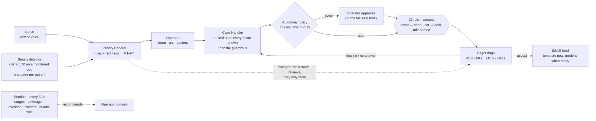
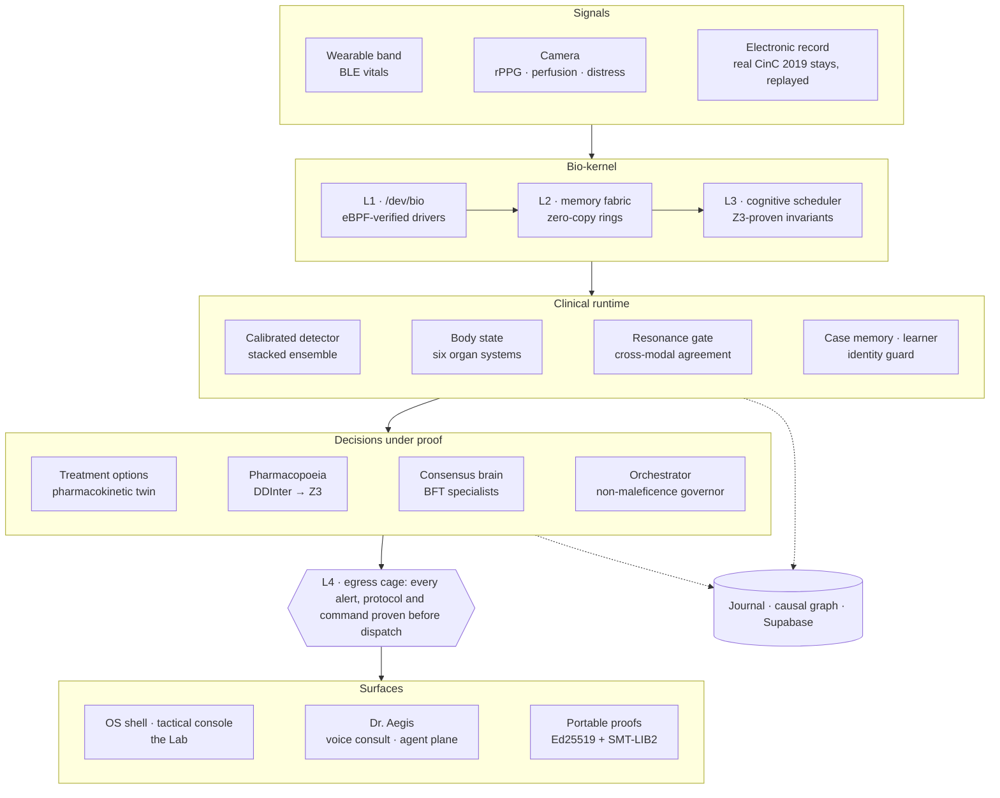

<div align="center">

# AegisOS

**Hospital paging that thinks. Every alert, whether a nurse's words or the sepsis detector's, reaches the right clinician in seconds, carrying a formal proof that the page obeys the hospital's policy.**

[](https://github.com/Arnavnemade1/Sepsis/actions/workflows/verify-os.yml)


[App routes](#app-routes) · [Agents](#agents) · [API](#key-api-endpoints) · [Architecture](#architecture) · [Subsystems](#subsystems) · [Quick start](#quick-start-local-dev) · [Deployment](#deployment) · [Findings](docs/FINDINGS.md) · [Verification](#how-a-claim-gets-in)

</div>

---

AegisOS is a realtime paging operating system for hospital floors. Alerts arrive two ways.
A nurse types or says what is happening in plain language, or the **sepsis detector** (a
calibrated model watching every monitored bed) crosses its alarm line. Every alert then
goes through the same steps:

1. It is triaged P1–P4 and located to a room and unit.
2. It is routed to the best clinician, with every factor in the decision shown.
3. **Z3 proves it against the hospital's paging policy before it is sent.**
4. It escalates automatically if nobody answers.

Whoever accepts finds a brief (SBAR, under 100 words) waiting on their pager.

Underneath is the operating system it grew out of. It has a kernel with a syscall gate,
schedulers, verified drivers and a hash-chained journal, built around a live model of each
patient. Around that runs a research program with one rule: **no number ships without the
dataset, the metric and the adversarial check that earned it.** That program built the
detector that pages. It has published more nulls than wins, and the nulls are why the wins
can be believed.

> [!IMPORTANT]
> Research and educational use only. AegisOS is not a medical device and must not be used
> for clinical decisions.


## At a glance

| | Where it stands |
|:--|:--|
| **Paging** | A typed P1 is triaged, located, routed, certified and ringing in single-digit milliseconds. Rules decide first; a language model reviews afterwards and **may only raise** a priority, never lower one. The brief is a template at once and the model's version when it arrives |
| **Room units** | Every occupied room is watched as one unit: the patient's prior record (problems, orders, allergies, code status, earlier encounters and the baseline measured there), the vitals the room is producing, and **19 detectors** that read both. NEWS2 switches to SpO₂ scale 2 when the record prescribes it; a systolic of 108 alarms against a baseline of 162 and not against one of 116; an allergy conflict pages pharmacy while a sepsis page is open. Findings page through the same certified pipeline, one room one page |
| **Policy, proven** | **Six invariants** are checked by Z3 on every page. A refused page is held for the operator with the broken rule named. If the prover itself is unhealthy, nothing is sent |
| **Guardrails** | Autonomy by unit and priority. Consecutive-paging protection. A workload limit. Near-tie load sharing. Hold-for-the-right-person. Auto-escalation on decline or timeout. A review fail-safe that routes around a clinician who has become unavailable |
| **Shipped detector** | A stacked ensemble trained on the patient label. Its members are two histogram boosters, extra-trees, logistic regression and a utility-aimed XGBoost. It was fitted on **24,206** CinC patients and calibrated without a staircase. On **6,852** held-out patients that neither it nor its predecessor saw: **AUROC 0.800** (predecessor 0.743), **ECE 0.003** |
| **At the bedside** | On those patients, at the deployed threshold, it flags **46%** of septic patients and **8.5%** of non-septic patients at least once. Inside a 15% alarm budget it catches **55%** (predecessor 41%). Catching more without raising the burden is the open problem |
| **Across hospitals** | **AUROC 0.68–0.70**, trained at one hospital and scored at the other. This is the honest deployment number |
| **The CinC 2019 ceiling** | With all 40 variables: **0.862** on a locked test set, scored once (**0.816** once the ICU clock is removed). The learning curve's asymptote is **0.887** |
| **MIMIC-IV** | Built end to end and verified on the open demo by **103 checks**, with every harness mechanism mutation-tested. The full run starts when credentialed access arrives |
| **Scale** | **1,000 beds** inside a 600 ms tick at p99 (p99 267 ms), on one laptop core, on real patients. Every scheduling decision is Z3-proven |
| **Verification** | **92 suites**. The paging OS has 70 checks and the room monitor 60, and each guard was first seen failing on the code it fixes; every record-aware detector claim is checked as a pair, with and without the piece of the record that changes it. The suites behind published claims plant known failures and require the guard to fire |

Thirteen findings, strongest first, and the published nulls are in
**[docs/FINDINGS.md](docs/FINDINGS.md)**.

---

## Live URLs

| Service | URL |
|:--|:--|
| **The app** (`frontend/`) | **https://aegis-clinical-beryl.vercel.app** |
| Operator console | https://aegis-clinical-beryl.vercel.app/operator/ |
| A clinician's pager | https://aegis-clinical-beryl.vercel.app/clinician/?id=dr.alvarez |
| Backend REST (Render) | https://sepsis-backend-omd1.onrender.com |
| Health | https://sepsis-backend-omd1.onrender.com/aegis/health |
| Paging stream (WebSocket) | `wss://sepsis-backend-omd1.onrender.com/aegis/paging/stream` |
| Live patient stream (WebSocket) | `wss://sepsis-backend-omd1.onrender.com/aegis/stream` |
| Legacy OS shell (`webui/`) | https://sepsis-three.vercel.app (and at the backend root), being retired |
| Public site (`site/`) | https://sepsis-jwf1.vercel.app |

The backend runs on Render's free tier. After 15 idle minutes it sleeps, and the first
request takes 30–60 s to wake it. The app says so and retries.

## App routes

There is no front page: the product is the console. `/` opens it directly, signed in as the
charge nurse of the demo hospital (switch users from the menu at the top right). Every screen
shares one frame: a sidebar grouping Operations, Clinical and Platform; a top bar with
connection latency, prover health and a 24-hour clock; and a command palette (`⌘K`) that
jumps to any section, active page, room, patient or pager.

| Route | Who | What it is |
|:--|:--|:--|
| `/operator/` | charge nurse · chief | **The operator console.** **Overview** has the live KPIs and the building in isometric: each active page on its room in its priority's colour, each clinician where they are, a ringing page as an arc from clinician to room. Beside it are the active-page queue (live countdowns; approve, escalate, cancel) and a watchlist of the rooms whose monitor sees something, with the event log one tab away. A room the monitor has flagged carries a corner mark in its worst finding's colour, and selecting any room opens its unit. **Pages** (`?view=pages`) lists every page with filters. **Staff** is the roster by service. **Sentinel** has the system-wide recommendations and dispatch performance. **Policy** holds the autonomy matrix, the guardrails and the six invariants; the chief can change them. `N` (or the palette) raises an alert by text or by voice. Selecting a page opens its inspector: the dispatch pipeline with timings, triage, the ranked routing table, the Z3 certificate, the timeline and the brief |
| `/clinician/?id=<user>` | any clinician | **The pager.** Pages for that clinician ring here with sound and vibration. Accept, and the brief is waiting. Decline (in a procedure, with another patient, not my service), and the next clinician is paged at once. On a phone the page is the pager. While it is open, nobody answers for that clinician. `/clinician/` lists every pager |
| `/room/` | everyone | **Rooms:** every occupied room as a tile, grouped by unit: NEWS2 (or sepsis risk in the ICU), the worst active finding, the trend, allergies, code status and any open episode. Filter to the rooms that need attention, or search by room, patient, finding or allergy |
| `/room/?id=<room>` | from anywhere | **One room as a unit.** Who is in it and what everyone must know first (allergies, code status, SpO₂ target). The scores the room is acting on. Every active detection with its evidence, the part of the record that changed the reading, the published rule's response and the page it is on. Vitals against their normal band and the patient's own baseline. Labs with the record's baseline. The record itself: problems, orders and home medications, earlier encounters. The care team, devices and pages linked to the room, and one timeline of everything that happened in it |
| `/patient/` | everyone | **The census:** every monitored bed ranked by the risk the unit acts on, with the population score, early-warning trend, leading system, drivers and any open page |
| `/patient/?id=<bed>` | from a page | One patient: the risk the unit acts on, vitals with trends, the 3D anatomical twin, organ systems (unmeasured shown as unknown), risk over time against the alarm line with its 8 h projection, the decision and its limits, orders through the Z3 cage, the specialist panel, and Dr. Aegis |
| `/pharmacy/?id=<bed>` | from a patient | Six candidate orders projected through a PBPK model of this patient, cited adverse events with confidence intervals, the Z3 verdict per path, and an interaction screen over 143,669 documented interactions compiled to Z3 |
| `/lab/` | research · chief | The deployed detector read from its promotion manifest, the operating point, conformal abstention, the falsification record, and every change the gate refused |
| `/os/` | chief · operators | **The platform.** **Architecture** is a live map of every layer of the OS: surfaces, the syscall gate, paging, decisions under proof, the clinical runtime, the bio-kernel, the signals and the record, each component with its own metrics and an inspector. **Kernel** (`?view=kernel`) has the process table with CPU shares, the scheduler's tiers and lanes, verified drivers, services and the boot waterfall. **Journal** is the hash-chained log with chain status and filters. **Syscall gate** has the reference monitor's statistics, the Z3 policy proof, the full syscall table and sessions. **Shell** is a terminal where every command is a syscall. Views a role may not read say so instead of failing silently |

The older routes still resolve: `/command/` goes to `/operator/`, `/bed/` to `/patient/`, and the old `?tab=` names map onto the new views.

### Aegis Memorial, the demo hospital

The demo hospital has seven floors, 18 units and 98 rooms:

| Floor | Units |
|:--|:--|
| A · Emergency | Emergency Department, Triage, Imaging |
| 1 · Admissions | Observation Unit, Central Pharmacy, Admitting |
| 2 · Surgery | Operating Rooms, Recovery (PACU) |
| 3 · Critical Care | Medical ICU, ICU Station, Surgical ICU |
| 4 · Cardiac | Step-down, Cardiac Telemetry |
| 5 · Medical–Surgical | 5 East, 5 West |
| 6 · Neuro & Oncology | Neuroscience, Oncology |

ICU rooms **301–312** replay twelve real de-identified PhysioNet/CinC 2019 stays, and the
detector watches them. Room **402** is the live monitored session (camera or wearable, or
the simulator when neither is connected). Every other patient is synthetic and labelled so.

Every occupied room carries a record and a monitor feed. An ICU room's record is the real stay
up to the current replay hour (every lab and vital measured so far; never a later hour, never
the challenge's label), and the dataset's gaps are named rather than filled. A synthetic room
has a synthetic longitudinal record and a simulated monitor built on the patient's own
baseline. Three demo behaviours run by default, and each can be switched off in Policy:

- **Demo traffic:** a synthetic nurse alert every few minutes, and now and then a simulated
  course in a synthetic room that its record makes plausible (sepsis, opioid sedation, rapid
  AF, hypoglycaemia, a bleed on an anticoagulant, fluid overload, hyperkalaemia, a COPD
  exacerbation, neutropenic fever) for the room monitor to catch. A nurse's report becomes the
  room's measurement, so an alert and the room's vitals never disagree.
- **Simulated responders:** they answer for any clinician whose pager is not open.
- **Room monitor pages:** a synthetic room's findings raise pages. Off, they are only shown.

### Staff accounts

| Username | Name | Role · ring | On the roster as |
|:--|:--|:--|:--|
| `rn.patel` | Priya Patel, RN | nurse · 1 | Charge nurse, runs the operator console |
| `dr.whitfield` | Dr. James Whitfield | chief · 4 | Chief of critical care; can change the paging policy |
| `dr.alvarez` · `dr.okafor` | Dr. Sofia Alvarez · Dr. Daniel Okafor | attending · 3 | Critical care |
| `dr.nakamura` · `dr.reyes` | Dr. Kenji Nakamura · Dr. Maria Reyes | attending · 3 | Hospital medicine |
| `dr.shah` · `dr.brennan` | Dr. Anika Shah · Dr. Liam Brennan | attending · 3 | Emergency medicine |
| `dr.adeyemi` | Dr. Tolu Adeyemi | attending · 3 | Cardiology |
| `dr.kowalski` | Dr. Ewa Kowalski | attending · 3 | Neurology |
| `dr.moreau` | Dr. Julien Moreau | attending · 3 | General surgery |
| `dr.fischer` | Dr. Hannah Fischer | attending · 3 | Anesthesiology |
| `dr.haddad` · `dr.lindqvist` | Dr. Rami Haddad · Dr. Anna Lindqvist | attending · 3 / remote consult · 1 | Infectious disease |
| `rn.ortiz` · `rn.kim` | Luis Ortiz, RN · Grace Kim, RN | nurse · 1 | Rapid response |
| `rx.chen` · `rx.silva` | Wei Chen, PharmD · Ana Silva, PharmD | pharmacist · 2 | Clinical pharmacy (notified on sepsis pages for the Hour-1 bundle) |
| `guest` | Guest | guest · 0 | View only |

Paging capabilities are checked by the gate:

| Capability | Who holds it |
|:--|:--|
| `page:raise` · `page:respond` | every signed-in role: nurse, pharmacist, remote consult, attending, chief |
| `page:dispatch` (approve, escalate, cancel, reassign) | nurses, attendings and the chief |
| `page:configure` (the policy screen) | the chief only |

Demo staff sign in without a passphrase (`AEGIS_DEMO_LOGIN=0` turns that off). The gate
runs in `audit` mode by default and records what it *would* refuse;
`AEGIS_GATE_MODE=enforce` makes the refusals real. One exception holds in both modes: a
session the kernel has rejected (forged, expired, or signed before a restart) never raises
or answers a page. Otherwise it would act as guest and an alert would be recorded under the
wrong name. The app renews a forgotten session and retries.

## Agents

| Agent | What it does | What it never does |
|:--|:--|:--|
| **Operator** | Runs each alert through triage → locate → route → certify → page, timing every step. Owns the escalation queue: ring timers by priority (P1 45 s · P2 90 s · P3 240 s · P4 480 s), holds, and the review fail-safe. Journals every decision | Leave a P1 waiting: a page held for review sends itself when the window ends, routing around a clinician who has become unavailable |
| **Priority Handler** | Sets P1–P4 from rules and red flags. Vitals are parsed from free text (SpO₂ in any phrasing, BP and MAP, HR, RR, temperature in °C or °F, lactate, GCS, NIHSS), with a Sepsis-3 / qSOFA screen. A language model then reviews in the background | Lower a page. A P1 red flag never waits for the model, and is never sent to it |
| **Case Handler** | Ranks every clinician with explicit points: service match, same unit, floors away, on call, caseload, procedures, whether their pager is open. Then it applies the guardrails as named steps: consecutive paging, workload, near-tie load sharing, off-shift, hold-for-the-right-person | Hide a factor. The drawer shows the whole table |
| **Sentinel** | Every 30 s it looks across the whole system for surges on one unit (several rooms, not one patient re-alarming), coverage holes, overload, escalation storms, sepsis clusters, and the Hour-1 bundle clock on an accepted sepsis page | Page anyone. It recommends; the operator decides |

The six invariants Z3 proves on every page (`backend/aegis/paging/policy.py`):

1. Never page an off-shift clinician, unless it is a P1 and no on-shift clinician can take it.
2. No clinician is paged twice within the consecutive window for different cases, unless it is a P1 with no alternative.
3. A P3 or P4 never goes to someone already holding more than the hourly workload limit.
4. The assignee's specialty is one the case accepts.
5. Where policy requires review, nothing is sent until the operator approves (or the review fail-safe fires for a P1/P2).
6. A P1 page escalates within 90 seconds if unanswered.

`unsat` (no way to violate them) means the page is sent. `sat` means it is held, with the
counterexample's invariant named.

## Key API endpoints

The backend is one FastAPI app, `backend.aegis.server:app`. The server module is the
composition root. Every endpoint lives in a domain router under
[`backend/api/routes/`](backend/api/routes/), and request bodies are in
[`backend/api/schemas.py`](backend/api/schemas.py). All **162** routes are numbered syscalls
in [`abi_table.json`](backend/aegis/kernel/abi_table.json), each bound to a capability the
gate checks (`abi` in the System shell lists them).

| Router | Routes | Key endpoints |
|:--|:--:|:--|
| `paging` | 18 | `GET /aegis/rooms` (every room as a unit) · `GET /aegis/rooms/{room}` (record, vitals, labs, findings, pages, care team, devices, timeline) · `POST /aegis/paging/alerts` (text or voice transcript → the whole pipeline) · `WS /aegis/paging/stream` (snapshot, then event batches; `?clinician=` marks a pager open) · `GET /aegis/paging/snapshot` · `GET /aegis/paging/hospital` · `POST /aegis/paging/pages/{id}/respond` · `…/approve` · `…/escalate` · `…/cancel` · `…/resolve` · `POST /aegis/paging/clinicians/{id}/status` · `POST /aegis/paging/recs/{id}/ack` · `GET`/`POST /aegis/paging/settings` |
| `live` | 8 | `WS /aegis/stream` (one snapshot per tick) · `GET /aegis/snapshot` · `POST /aegis/ingest` (real telemetry) · `GET /aegis/decision?bed=` · `GET /aegis/timeline` · `POST /aegis/simulate/{stage}` |
| `patients` | 20 | `GET /aegis/patients` · `GET /aegis/patient/snapshot?bed=` · `WS /aegis/cluster/stream` (the ward) · `GET /aegis/cohort/{bed}/chart` · `GET /aegis/cohort/{bed}/bundle` · `GET /aegis/identity` |
| `pharmacy` | 9 | `GET /aegis/pk/options?bed=` · `POST /aegis/pk/project` · `POST /aegis/pharmacopoeia/screen` · `POST /aegis/dsl/verify` |
| `governance` | 19 | `GET /aegis/orchestrator` · `GET /aegis/consensus?bed=` · `POST /aegis/proof/verify` · `GET /aegis/orchestrator/proof/{seq}/bundle` · `POST /aegis/syscall` · `GET /aegis/fedlearn` · `GET /aegis/rbac/policy` |
| `ai` | 15 | `POST /aegis/doctor/consult` · `WS /aegis/doctor/live` (voice) · `GET /aegis/doctor/brief?bed=` · `POST /aegis/agent/invoke` · `GET /aegis/hyperscan` |
| `research` | 14 | `GET /aegis/lab/evidence` · `GET /aegis/lab` · `POST /aegis/ml/train` · `GET /aegis/scenarios` |
| `system` | 30 | `POST /aegis/sys/login` · `GET /aegis/sys/whoami` · `GET /aegis/sys/ps` · `GET /aegis/sys/journal` · `GET /aegis/sys/boot` · `GET /aegis/sys/gate` · `GET /aegis/fs/ls` · `GET /aegis/fs/read` · `WS /aegis/os/stream` |
| `kernel` | 11 | `GET /aegis/kernel/devices` · `POST /aegis/kernel/verify` · `GET /aegis/services` · `GET /aegis/proc/{path}` · `GET /aegis/hdkernel` |
| `devices` | 10 | `GET /aegis/devices` · `POST /aegis/devices/{id}/pair` · `GET /aegis/ppg/morphology` |
| `causal` | 4 | `GET /aegis/causal?bed=` · `GET /aegis/causal/incident/{node}` · `POST /aegis/causal/replay` |
| `health` | 4 | `GET /aegis/health` · `GET /aegis/health/system` · `GET /aegis/audit` |

Auth: `POST /aegis/sys/login` returns a token. Send it as `Authorization: Bearer <token>` over
HTTP, and as the WebSocket subprotocol `aegis.session.<token>`, because browsers cannot set
headers on a socket. Never send it in a query string: URLs end up in logs.

## Architecture

```text
Browser (frontend/, static on Vercel)          operator console · pagers · drill-downs
  │
  ├─ REST ─────────► FastAPI  backend.aegis.server:app  (Render)
  │                    │
  │                    ├─ kernel gate ── every call: resolve syscall → authenticate → decide (audit | enforce)
  │                    ├─ backend/api/routes/*  (12 domain routers, 162 syscalls)
  │                    └─ composition root: kernel · session · ICU wing · paging OS · scheduler · journal
  │
  ├─ WS /aegis/paging/stream ──► the hospital: snapshot, then one batch of paging events a second
  ├─ WS /aegis/stream ─────────► the live patient, one snapshot per tick
  ├─ WS /aegis/cluster/stream ─► the ward: 12 beds, scheduler, certified egress
  └─ WS /aegis/doctor/live ────► voice consult, relayed to Gemini Live (the key never reaches the browser)

Persistence: Supabase (real telemetry, the kernel journal, causal graphs) · SQLite fallback
```

A page moves through the paging OS ([`backend/aegis/paging/`](backend/aegis/paging/)) like this:



Underneath the paging OS, one tick of the clinical runtime flows through the layers:



One tick moves top to bottom:
1. Drivers publish into ring buffers in a zero-copy memory fabric.
2. A scheduler, whose invariants are proven in Z3, decides which beds get compute first.
3. The clinical runtime turns each bed's window into a risk, a body state and the evidence
   behind them.
4. Candidate actions are checked against pharmacology and hospital policy.
5. No alert, protocol, actuator command or automated note is dispatched until Z3 has proven
   it against the medical invariants. A failed proof quarantines the output.

Everything that happens is appended to a tamper-evident journal.

## Subsystems

Over forty subsystems, grouped by the layer they live in. Each has its own `verify_*.py`.

<details>
<summary><b>The paging OS</b> · <code>backend/aegis/paging/</code></summary>

<br/>

| Module | What it is |
|:--|:--|
| `triage.py` | The Priority Handler. Rules and red flags from free text: room extraction that won't read "HR 104" as room 104, vitals in any phrasing ("sats 86% on 4L", "desaturating to 84% on room air", the first reading in a plausible range), a Sepsis-3 / qSOFA screen. A model refinement step that may only raise |
| `router.py` | The Case Handler: specialty and co-notification maps, explicit per-clinician points, then the guardrails as named steps |
| `policy.py` | Autonomy by unit and priority, ring timers, the six invariants, and the Z3 certificate (`unsat` = send) |
| `engine.py` | The Operator: the pipeline per alert, the escalation queue, holds, the review fail-safe, detector episodes (hysteresis 0.70 / 0.60, one page per patient while one is open), simulated responders and demo traffic, both labelled synthetic |
| `sentinel.py` | Six patterns over the whole system, each with evidence, a recommendation and a clear condition |
| `sbar.py` | The brief: facts first from the record, a template at once, the model's version when it arrives; under 100 words |
| `hospital.py` · `demo.py` | Aegis Memorial (7 floors, 18 units, 98 rooms, 18 staff) and the demo scenarios |

`make verify-paging` runs its 70 checks.

</details>

<details>
<summary><b>Room units</b> · <code>backend/aegis/rooms/</code></summary>

<br/>

| Module | What it is |
|:--|:--|
| `records.py` | The record each room carries. Synthetic rooms: problems with the year they began, home medications, inpatient orders with doses, allergies with the reaction, code status, earlier encounters with the vitals taken at each (the personal baseline is their mean) and recent labs. ICU rooms: the real stay up to the current hour, read from whitelisted columns only. Room 402: the session's history |
| `detectors.py` | The detection library, pure functions of the room: NEWS2 (scale 2 from the record, confusion scored only when new), qSOFA, SIRS, shock index and MAP, personal-baseline deviation, least-squares trend, opioid sedation, neutropenic fever (on antibiotics or not), hypoglycaemia levels, AF with RVR, bleeding on antithrombotics, KDIGO, potassium, lactate, SOFA from real ICU labs, the sepsis detector, medication safety, the Morse fall scale and device health. Each finding names its source, its evidence and the record context that changed it. A detector that raises is reported, never allowed to blind the room |
| `formulary.py` | The ward formulary (doses, classes, renal thresholds, QT risk), allergy rules with honest cross-reactivity, and curated pair rules that know an expected regimen (heparin with aspirin in an NSTEMI) from an error. The pharmacopoeia's interaction screen is consulted as well |
| `physiology.py` | The synthetic rooms' monitor: the patient's baseline shifted by today's illness, Ornstein–Uhlenbeck drift, and the courses a record makes plausible, which hold until someone has the page and then recover |
| `monitor.py` | The room monitor, ticked by the paging OS: re-runs a room's detectors when its inputs change, debounces findings into episodes (open after two evaluations, resolve after five), writes each room's timeline and escalates on two tracks per room, the patient's physiology and the medication record, so an allergy conflict reaches pharmacy even while a sepsis page is open. ICU rooms and the live session stay with the sepsis detector |

`make verify-rooms` runs its 60 checks, including three planted defects: NEWS2 ignoring the
record's target, the ICU record reading ten hours ahead, and the monitor paging a room twice.

</details>

<details>
<summary><b>The bio-kernel</b> · <code>backend/aegis/kernel/</code></summary>

<br/>

| Layer | Modules | What it is |
|:--|:--|:--|
| **L1 · Devices** | `devbio.py` `ebpf.py` `ebpfdrv.py` `runtime.py` `supervisor.py` | `/dev/bio` is one driver architecture for every sensor. Untrusted drivers pass a static verifier (termination, memory safety, capabilities) before they run, and a supervisor isolates a faulting driver under live load |
| **L2 · Memory** | `memfabric.py` | A zero-copy virtual memory fabric of per-signal ring buffers |
| **L3 · Scheduling** | `scheduler.py` `hdsched.py` `hdkernel.py` | A multi-tenant cognitive scheduler with Z3-proven invariants that folds critical-slowing-down foresight into bed priority. HDSched is a CPU scheduler benchmarked against classical policies. HDKernel is a live cooperative kernel that runs coroutine tasks with syscalls, IPC and a process table |
| **L4 · Egress** | `neurosym.py` | The formally verified neurosymbolic cage. Every dispatched alert, protocol, actuator command and automated note is proven in Z3 first; a failed proof quarantines it |
| **Fusion** | `fusion.py` | The sepsis ontology that aligns every modality |
| **Security** | `gate.py` `abi.py` `policy.py` `policyfile.py` `users.py` | One reference monitor that every call crosses. A numbered, capability-bound syscall ABI, with the access policy checked against the whole syscall table. The hospital's policy lives in `/etc/policy.dsl`. Accounts, sessions and break-glass |
| **Record** | `journal.py` `causal_graph.py` `proc.py` `vfs.py` `boot.py` `executor.py` `osstream.py` | A tamper-evident journal, and the patient's temporal causal graph as a kernel object. A process table with real accounting, a virtual filesystem and a boot sequencer. A single-writer executor, and one capability-filtered socket per desktop |
| **Payload** | `bundle.py` | The Hour-1 Sepsis Bundle engine |

Every layer has its own `verify_*.py`. Run them all with `make verify-os`.

</details>

<details>
<summary><b>The clinical runtime</b> · <code>backend/aegis/</code></summary>

<br/>

| Module | Role |
|:--|:--|
| `os.py` · `core.py` | `AegisOS` boots and owns the layers; `AegisCore` is the assessment runtime it composes |
| `cohort.py` | Drives the OS from real CinC 2019 ICU stays, bed by bed |
| `streaming_features.py` | One feature builder for training and serving, so the two cannot skew |
| `body_state.py` | The multi-organ dysfunction model behind the 3D twin |
| `resonance.py` | Cross-modal HDC resonance. A real deterioration moves every acquisition pathway; a sensor glitch moves one, which the gate rejects. It removes 91% of artifact false alarms (leave-one-patient-out on real CinC data) |
| `hdc_memory.py` | Hyperdimensional case memory: encode a patient-hour, retrieve precedent |
| `learner.py` | Per-patient baselines and interpretable deviation |
| `identity.py` | A physiologic fingerprint that detects a swapped sensor stream and locks dispensing (the lock is proven in Z3). It is a stream-swap detector, not biometric identity |
| `resilience.py` | The critical-slowing-down radar |
| `forecast.py` · `physiology.py` · `scheduler.py` | Trajectory forecasting and the what-if treatment projection |
| `disposition.py` · `alert_episodes.py` · `risk_timeline.py` · `evidence_router.py` | What the system *does* with a score: one auditable disposition (abstention may never downgrade), alert episodes instead of per-tick alarms, and an advisory evidence router |
| `system_health.py` · `hyperscan.py` | The OS measuring its own detection quality, and a sweep across every subsystem |

</details>

<details>
<summary><b>Safety and governance</b> · formal where it can be, honest where it cannot</summary>

<br/>

| Module | What it guarantees, stated precisely |
|:--|:--|
| `clinical_dsl.py` | Hospital-authored safety rules (`RULE` / `ALWAYS` / `WITHIN`) compiled to Z3. It proves protocols, returns counterexamples and checks the policy for consistency. This is a bounded fragment, not full temporal logic |
| `pharmacopoeia.py` | A real interaction graph (DDInter: ~143k edges over ~1.8k drugs), fused with CYP450, QT-risk and renal layers. Every hazard becomes a dynamic Z3 constraint with a proof tree. It is exhaustive over the loaded knowledge base, which is not the entire pharmacopoeia |
| `pharmacokinetics.py` · `adverse.py` · `treatment_options.py` | A PBPK twin that tracks where an ordered drug goes, organ by organ. Adverse-event projections are anchored to published rates, and several candidate orders are projected through the body. An evidence firewall keeps projections from becoming efficacy claims |
| `consensus.py` | Byzantine-fault-tolerant consensus among specialist agents (N = 3f+1, HMAC-signed quorum certificates). Liveness comes from physiology rather than a timeout: if the patient decompensates before quorum, a pre-certified emergency protocol commits |
| `orchestrator.py` | One architectural invariant across sensor, bed, wing and global layers: no action reaches a patient without a safety certificate. Every governed action is attested |
| `proofexport.py` | Ed25519-signed SMT-LIB2 certificates that a third party re-checks with their own solver, trusting nothing of ours. A signed lie is caught by the re-check |
| `rbac.py` · `syscalls.py` · `z3lock.py` | Five roles across four privilege rings, deny-by-default, with policy soundness proven in Z3. Write syscalls are audited and gated; the solver is concurrency-safe |
| `fedlearn.py` | Federated logistic regression across hospitals: no records leave a node, updates are signed, and aggregation is robust to poisoners. It claims data minimisation, not differential privacy |
| `causal_*.py` · `counterfactual.py` | The clinical story as a hash-chained causal graph: ingestion, durable storage, cohort pattern mining and counterfactual replay |

</details>

<details>
<summary><b>The platform</b> · apps, services, agents and the research plane</summary>

<br/>

| Module | Role |
|:--|:--|
| `apps/` · `initd.py` · `pkg.py` · `procfs.py` | Capability-confined apps with an SDK, the `aegisd` service manager, a verify-then-install package registry, and `/proc` |
| `agent.py` · `agents.py` | The agent plane: 56 capability-bound tools through which Dr. Aegis operates the OS, with writes crossing the same gate a human's do. Plus a five-agent debate that reaches consensus |
| `lab.py` · `lab_runner.py` · `lab_registry.py` | The Lab. Agents propose changes, a locked gate on patients no agent can see adjudicates them, and a disjoint pool decides replication. Agents run the research; they never judge it ([docs/LAB.md](docs/LAB.md)) |
| `scenarios.py` | The Scenario Lab: synthetic cases the AI authors and the detector is graded on, behind a synthetic-data firewall |
| `mlctl.py` | Train and specialise detectors from the OS terminal. Models are registered, never hot-swapped into the certified path |
| `patient_terminal.py` · `patient_records.py` | A terminal for each bed (tracking foci, watch rules) and medical-history intake |
| `devices.py` | Device pairing and management |
| `scale/loadgen.py` | The bed-count load harness |
| `server.py` · `stream.py` | The composition root (kernel bring-up, session, cohort, drive loops) and the versioned snapshot contract. The routes live in `backend/api/routes/` |

</details>

### Sensors, language and surfaces

| Package | What it is | Validation |
|:--|:--|:--|
| [`backend/vision/`](backend/vision/README.md) | Contactless optical biosensor: rPPG heart rate, HRV and respiration from a webcam, plus micro-perfusion and sympathetic-distress proxies | Heart rate within ~3 bpm against synthetic ground truth. The perfusion and distress proxies are trend-only |
| [`backend/physio/`](backend/physio/README.md) | HRV (including HeRO descriptors), PPG morphology, cardio-respiratory coupling, autonomic recovery | PPG-derived HRV against ECG on real BIDMC patients: heart rate MAE ≈ 1.2 bpm, SDNN correlation ≈ 0.71 |
| `backend/llm/` | Dr. Aegis, a colleague you can call about a bed, by voice (Gemini Live relay) or text. Grounded in the bed's dossier, read-only by construction, and required to volunteer the detector's real external AUROC whenever it quotes a risk. Provider failover, cooldowns, caching and a budget, with a deterministic fallback so the OS never depends on an LLM | `make verify-doctor` · `make verify-llm` |
| [`frontend/`](frontend/README.md) | The clinical app: five role workspaces over one running system, with the 3D anatomical twin (HuBMAP CCF organs), the PK comparison, the Z3 interaction screen, the refusal ledger and a shell on the kernel | `npm run typecheck` · `npm run build` |
| `webui/` | The previous single-page OS shell (windowed desktop, camera rPPG, tactical console, validation report). Kept deployed until every feature has a home in `frontend/` | `make check-webui` |
| [`site/`](site/README.md) | The public website: Next.js 16, Tailwind v4, Motion and Remotion. It renders only results committed to the repo | `npm run typecheck` |

---

---

## Project structure

```text
.
├── frontend/             the app (Next.js 16 static export): /operator /clinician /patient /pharmacy /lab /os
│   ├── app/              one directory per route
│   ├── components/       paging/ (floor view, queue, drawer, composer, panels), shell, UI primitives, bedside panels, the terminal
│   ├── engine/           the Three.js anatomical twin (ported from webui/twin3d.js)
│   └── lib/              the API client (gate token, session renewal), the paging store, live-feed hooks, clinical colour rules
├── backend/
│   ├── api/              the REST surface: routes/ (12 domain routers) and schemas.py
│   ├── aegis/            the operating system: runtime, clinical services, safety, platform
│   │   ├── paging/       the paging OS: triage, routing, policy + Z3 certificate, queue, sentinel, SBAR
│   │   ├── kernel/       /dev/bio, memory fabric, schedulers, egress cage, gate, ABI, journal, VFS
│   │   ├── apps/         capability-confined apps and their SDK
│   │   └── scale/        the bed-count load harness
│   ├── ml/               detection research on CinC 2019 (genesis/, mimic/, quantum/)
│   ├── vision/           contactless optical biosensor
│   ├── physio/           HRV, PPG morphology, coupling, autonomic recovery
│   ├── llm/              Dr. Aegis: grounded consult, voice relay, provider failover
│   ├── hostresponse/     the pre-registered GEO gene-expression study
│   └── core/             the original primitives: HDC, simulator, neurosymbolic rules, Z3 verifier
├── deploy/               how each piece is deployed (Vercel, Render, Supabase)
├── webui/                the previous OS shell, being retired
├── site/                 the public Next.js site
├── docs/                 FINDINGS.md and one report per finding
├── artifacts/            shipped models, evaluation JSON, ledgers (large caches are gitignored)
├── supabase/             the persistence schema and migrations
├── render.yaml           the backend's Render blueprint
└── Makefile              the command surface (`make help`)
```

The project began as *HyperSepsisTwin-Ω*, and that name survives in older modules.
[`docs/REPO_MAP.md`](docs/REPO_MAP.md) marks which paths are production-facing and which
preserve history.

## Quick start (local dev)

**1) Backend**

```bash
git clone https://github.com/Arnavnemade1/Sepsis.git && cd Sepsis
make setup            # .venv + backend/requirements.txt
make verify-os-fast   # the OS layer and the paging OS; needs no datasets (what CI runs)
make serve            # API + WebSockets on http://127.0.0.1:8100
```

**2) Clinical app**

```bash
cd frontend
cp .env.example .env.local    # NEXT_PUBLIC_AEGIS_BACKEND=http://127.0.0.1:8100
npm install
npm run dev                   # http://localhost:3000
```

Open http://localhost:3000 and open the operator console as **Priya Patel, RN**. In a second
window open a pager, for example http://localhost:3000/clinician/?id=dr.alvarez. Raise an
alert with `N` ("Room 305 BP 84/50, febrile 39.2, new confusion"), watch it route, and
answer it on the pager. A patient opens at `/patient/?id=bed_6`.

**3) Research lines** (need datasets, plus two libraries kept out of the serving image)

```bash
.venv/bin/pip install lightgbm torch              # GENESIS and MIMIC-IV
python -m backend.ml.data.cinc2019 --download     # PhysioNet/CinC 2019 (~40k patients)
make verify                                       # end to end (needs CinC)
make verify-genesis
make verify-mimic   # needs the open MIMIC-IV demo in data/mimic_demo/
make mimic-demo     # the whole MIMIC-IV pipeline on the demo, ~3.5 min
```

## Deployment

| Piece | Where | Notes |
|:--|:--|:--|
| Clinical app (`frontend/`) | Vercel (`aegis-clinical`) | Root `frontend`, git-linked to `main`; a push that touches `frontend/` redeploys it. Static export: per-patient pages take the patient as `?id=`, so no server is needed. Organ meshes cached immutable |
| Legacy shell · public site | Vercel (`sepsis` · `sepsis-jwf1`) | Roots `webui` and `site`, both git-linked to `main` |
| Backend (`backend/`) | Render, from [`render.yaml`](render.yaml) | FastAPI, the WebSockets and the live drive loops. Commits touching only `frontend/`, `webui/`, `site/` or docs do not redeploy it |
| Persistence | Supabase | Real camera telemetry (raw 7 days, 1-minute rollups kept), the kernel journal and files |
| CI | GitHub Actions | `verify-os` on every push, and a keep-warm ping inside a fixed daily window that fits Render's free tier |

The full walkthrough is in [`deploy/README.md`](deploy/README.md).

## Environment variables

| Variable | Where | Default | What it does |
|:--|:--|:--|:--|
| `NEXT_PUBLIC_AEGIS_BACKEND` | frontend (build time) | same origin | The backend URL the app talks to. A browser can override it with `localStorage.aegis_backend` |
| `SUPABASE_URL` · `SUPABASE_KEY` | backend | unset → SQLite | Persistence (service-role key; never committed) |
| `GEMINI_API_KEY` | backend | unset | Primary LLM: the voice consult, the paging model's triage review and the written brief. Without a key, paging runs on its rules and the template brief, and says so |
| `OPENROUTER_API_KEY` · `OPENROUTER_MODEL` | backend | unset | Text-only backup provider, so a Gemini quota wall degrades the consult instead of removing it |
| `AEGIS_SESSION_SECRET` | backend | random per boot | Signs session tokens. Set it in production: without it every restart forgets every session (the app renews demo sessions on reconnect, but a real deployment should not rely on that) |
| `AEGIS_GATE_MODE` | backend | `audit` | `off` · `audit` (record would-be refusals) · `enforce` |
| `AEGIS_DEMO_LOGIN` | backend | `1` | Demo staff sign in without a passphrase; `0` requires one |
| `AEGIS_ACCOUNTS` | backend | built-in demo staff | Additional accounts (see `backend/aegis/kernel/users.py`) |
| `AEGIS_JOURNAL_DB` · `AEGIS_CAUSAL_DB` | backend | under `artifacts/` | SQLite paths for the journal and causal graphs |
| `KEEPALIVE_URL` | backend | `RENDER_EXTERNAL_URL` | What the keep-alive thread pings |

## How a claim gets in

Most test suites check that code runs. These check that **claims are true**, and that the
machinery built to refuse a false claim actually refuses it.

1. **Plant the failure.** A guard is trusted only after it has been shown a known lie and
   fired. The lies include shuffled labels, a planted future spike, a leaking column and a
   forged certificate.
2. **Break the check.** The mechanism is broken on purpose and the check must go red. A
   green assertion is not evidence until it has been seen to fail.
3. **Spend the lock once.** Test patients are split off before design work and scored once,
   and the spend is recorded in an append-only ledger. Pre-registrations are committed
   before the data they judge is loaded.
4. **The patient is the unit.** Folds are patient-grouped and intervals are patient
   bootstraps.
5. **A refusal is a result.** The promotion gates, the self-improvement loop, the Lab and
   the alarm-policy search all record what they refused and why.

| Command | What it attacks |
|:--|:--|
| `make verify` | End to end, 24 tests: data, features, detector, calibration and runtime (needs CinC) |
| `make verify-os-fast` | The whole OS layer across 14 suites: kernel, apps, `aegisd`, packages, RBAC, proofs, DSL, consensus, orchestrator, Z3 concurrency, the ABI, and every optimised fast path held to the code it replaced (bit-exact, or to 1e-15 where a forest's thread order moves the last bits). CI runs it on every push |
| `make verify-integrity` | Planted lies: shuffled labels must collapse to chance, and in-sample scores must be caught |
| `make verify-frontier` | Causality, the exact utility and the leakage tripwire |
| `make verify-genesis` | 35 checks, including the causality of every feature column under rewritten and truncated futures, the clock control, lock isolation, and the fast LightGBM ingestion training byte-identical models |
| `make verify-mimic` | 103 checks on the open demo, attacking every harness layer with a planted failure |
| `make falsify` | Mutates scientific invariants and requires that a *named* check fails |
| `make verify-lab` | 90 checks on the Lab's gate, replication pool and nulls |
| `make verify-conformal` · `verify-shift` · `verify-subgroup` · `verify-op` | Planted leakage, shift, degeneracy and per-group thresholds, and the detector's identity |

`make help` lists every target.

---

`make help` lists every target.

---

## Data

| Dataset | Access | Used for |
|:--|:--|:--|
| [PhysioNet/CinC 2019](https://physionet.org/content/challenge-2019/1.0.0/) | Open | The detection line and GENESIS: 40,335 ICU patients from two hospitals |
| [MIMIC-IV demo 2.2](https://physionet.org/content/mimic-iv-demo/2.2/) | Open (ODbL) | Verifying the MIMIC-IV pipeline on 100 real patients |
| [MIMIC-IV](https://physionet.org/content/mimiciv/) | Credentialed, via BigQuery | The full MIMIC-IV run |
| [MIMIC-III Waveform](https://physionet.org/content/mimic3wdb/) | Open | The autonomic-recovery study (ECG predictor, arterial-line outcome) |
| [VitalDB](https://vitaldb.net/) | Open | The confound-controlled recovery retest |
| [BIDMC PPG and Respiration](https://physionet.org/content/bidmc/1.0.0/) | Open | Camera-path HRV validation against ECG |
| GEO GSE74224 · GSE40012 | Open | The host-response study |
| [DDInter](https://ddinter.scbdd.com/) | CC BY-NC-SA | The drug-interaction graph |
| HuBMAP CCF organ models | CC BY 4.0 | The 3D anatomical twin |

Datasets are never committed. Each one is redistributed only by its own source.

## Documentation

| Report | The question it answers |
|:--|:--|
| [FINDINGS](docs/FINDINGS.md) | The thirteen findings, the published nulls, the three research lines and the MIMIC-IV chapter |
| [GENESIS](docs/GENESIS.md) | How far hourly early warning goes with all 40 CinC variables, and why 0.90 is out of reach there |
| [MIMIC](docs/MIMIC.md) | The MIMIC-IV pipeline: data, label, harness, temporal model, levers and runbook |
| [DATA_LEVER](docs/DATA_LEVER.md) | More patients: a registered win, two refusals, and the four defects shipping it exposed |
| [CALIBRATION_RESOLUTION](docs/CALIBRATION_RESOLUTION.md) | Calibrating without a staircase: the ranking isotonic threw away |
| [SUPERVISION_DENSITY](docs/SUPERVISION_DENSITY.md) | Why sepsis detection is patient classification, and the lever that follows |
| [FRONTIER_REPORT](docs/FRONTIER_REPORT.md) | What actually moved the number: the objective, and a disagreeing member |
| [LEAD_TIME_NULL](docs/LEAD_TIME_NULL.md) | Why median lead time does not measure early warning |
| [TRANSFER](docs/TRANSFER.md) | Label-free deployment transfer, a decisive negative |
| [CONFORMAL](docs/CONFORMAL.md) | The alarm's third state, and why its guarantee does not travel |
| [SUBGROUP_AUDIT](docs/SUBGROUP_AUDIT.md) | Who the detector serves worse |
| [FALSIFICATION](docs/FALSIFICATION.md) | What was actually invented here, and proving the checks can fail |
| [SCALE](docs/SCALE.md) | How many beds the OS runs, and what gives way first |
| [LAB](docs/LAB.md) | The agent research plane and its locked gate |
| [PHASE7_REPORT](docs/PHASE7_REPORT.md) | Accuracy, cross-hospital generalisation and feature science on the wearable line |
| [AUTONOMIC_RECOVERY](docs/AUTONOMIC_RECOVERY.md) · [RECOVERY_NULL](docs/RECOVERY_NULL.md) | A new detection algorithm, and its pre-registered failure |
| [HOST_RESPONSE_NULL](docs/HOST_RESPONSE_NULL.md) | Gene expression across cohorts: bar missed |
| [SEQUENCE_PATIENT_NULL](docs/SEQUENCE_PATIENT_NULL.md) | Patient supervision on a sequence model: refused |
| [HDC_MEMBER_NULL](docs/HDC_MEMBER_NULL.md) | HDC case retrieval as a stack member: registered null, and a stacking-test flaw its noise control caught |
| [ALGORITHM_ROADMAP](docs/ALGORITHM_ROADMAP.md) · [AERIS_RESEARCH](docs/AERIS_RESEARCH.md) | What comes next, with falsifiable success criteria |
| [TACTICAL_SPHERE_FRONTEND](docs/TACTICAL_SPHERE_FRONTEND.md) | The design spec for the tactical console |
| [REPO_MAP](docs/REPO_MAP.md) | Which paths are production, which are research and which are history |

Each subsystem also has its own README:
[ml](backend/ml/README.md) · [aegis](backend/aegis/README.md) ·
[vision](backend/vision/README.md) · [physio](backend/physio/README.md) ·
[hostresponse](backend/hostresponse/README.md) · [frontend](frontend/README.md) · [deploy](deploy/README.md) · [site](site/README.md).

## Honest boundaries

- **Retrospective data validates algorithms, not a device.** No result here comes from a
  prospective cohort.
- **The deployment number is the cross-hospital AUROC (≈ 0.69)**, not the within-site one.
- **Lead times are not evidence of early warning.** See finding 6.
- **Camera optics are validated only on synthetic faces.** Real rPPG video datasets are tens
  of gigabytes, and that link stays open.
- **HRV → sepsis needs credentialed waveform labels.** The adapter is built and waiting.
- **MIMIC-IV results do not exist yet.** Demo numbers are noise at 99 patients, and every
  demo report says so.
- **The room monitor runs published rules, not a trained model.** Its detectors are checked
  against hand-computed answers and planted failures, not against outcomes. Synthetic rooms run
  on simulated vitals and every course there is labelled simulated.

## License

Research and educational use only. **Not a medical device; not for clinical use.** Datasets
remain under their own licenses and are not redistributed here.
