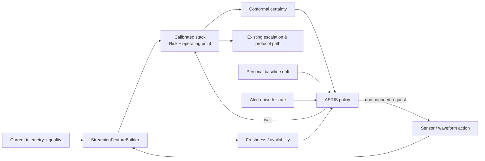

# AERIS — Adaptive Evidence Routing for Intelligent Sepsis

## Research status

**Proposal and pre-registration plan. Not trained, not clinically validated, and
not connected to treatment or paging.**

## The invention

Current AegisOS has a strong *passive* decision path: it turns whatever signals
arrive into a calibrated risk, an uncertainty set, a personal trajectory, and an
alert episode. Its remaining problem is that an uncertain or stale assessment
does not say what evidence is worth obtaining next. Treating every absent signal
as equally important wastes compute, sensor battery, and clinician attention;
forcing the current score into an alert wastes trust.

**AERIS** is an active evidence router placed *after* the calibrated detector,
not a replacement for it. At each tick it selects exactly one of:

```text
WAIT | REACQUIRE(<channel>) | COMPUTE_WINDOW(<derived-signal>) | ESCALATE_FOR_REVIEW
```

It only makes an evidence request. It never changes the sepsis probability,
risk tier, conformal set, protocol, or notification decision. Once new evidence
arrives, the existing `StreamingFeatureBuilder` and calibrated detector score it
normally.

The essential idea is **selective sensing**: run the low-cost, validated tabular
path continuously; spend scarce acquisition/compute budget only when the
expected decision value of an additional signal exceeds its measured cost.

## Why this is the right next bet

The repo's own negative results rule out another round of tabular architecture
search or threshold polish: the ranker is data-limited, and existing conformal
abstention is intentionally informational rather than an auto-silence rule. But
the necessary building blocks already exist:

| Existing Aegis component | AERIS role |
|---|---|
| calibrated stacked detector + operating point | fixed base decision; never re-fit inside routing |
| conformal `certainty` | identify an unresolved prediction without rounding it down |
| missingness and channel-age features | identify stale or unavailable evidence |
| `PatientBaselineLearner` | detect a within-patient change that makes a fresh measurement more valuable |
| `alert_episode` | limit repeated requests and preserve immediate HIGH escalation |
| rPPG/PPG, HRV and waveform adapters | demand-only derived-signal actions |

The external evidence supports this direction, while also setting the bar for
honesty:

* Active feature acquisition is explicitly designed to trade information against
  measurement cost; the 2024 ACO work warns that greedy acquisition misses jointly
  informative actions. [Valancius, Lennon & Oliva (ICML 2024)](https://proceedings.mlr.press/v235/valancius24a.html)
* Dynamic ICU measurement scheduling has shown potential in off-policy evaluation,
  but it is not a license to deploy a reinforcement learner: its claimed costs and
  gains require a prospective check here. [Chang et al. (ICML 2019)](https://proceedings.mlr.press/v97/chang19a/chang19a.pdf)
* MIMIC-IV Waveform provides aligned waveform segments and monitor numerics, while
  documenting patient/record identity caveats that must be respected in a
  patient-disjoint study. [PhysioNet MIMIC-IV Waveform documentation](https://physionet.org/content/mimic4wdb/0.1.0/waves/)
* The open BIDMC data pairs PPG, ECG, respiration, numerics and manual breath
  annotations — enough to validate acquisition *quality* and feature recovery,
  but not sepsis discrimination. [PhysioNet BIDMC dataset](https://physionet.org/content/bidmc/1.0.0/)
* The evaluation target must include alert burden and timing at the admission
  level, not only AUROC. [JAMIA's effectiveness–efficiency–utility framework](https://academic.oup.com/jamia/article/33/2/304/8320456)

## Architecture



### Action catalogue, deliberately small at first

| Action | Evidence it asks for | Cost dimensions | Initial eligibility |
|---|---|---|---|
| `WAIT` | none | zero | default |
| `REACQUIRE(map)` | fresh cuff / validated BP measurement | time, patient disturbance | MAP stale or quality failed and physiology is concerning |
| `COMPUTE_WINDOW(hrv)` | bounded PPG/ECG window -> HRV/recovery features | CPU, battery, signal quality | adequate pulse-quality buffer and unresolved risk |
| `COMPUTE_WINDOW(respiration)` | bounded PPG/ECG/camera respiratory estimate | CPU, motion sensitivity | respiratory channel stale and signal quality sufficient |
| `REACQUIRE(spo2)` | fresh saturation value | time, sensor contact | SpO2 is absent/stale with hypoxemia-compatible trajectory |
| `ESCALATE_FOR_REVIEW` | human review, not another automated test | interruption | hard rule already fired or acquisition is unavailable |

No action recommends an invasive test, drug, treatment, or diagnosis. Actions
whose source device is not actually available are ineligible rather than scored
as imaginary evidence.

## Policy, version 0: an auditable baseline before learning

The first version must be deterministic, cheap, and falsifiable. It routes only
when all gates hold:

1. The base risk is MEDIUM/HIGH **or** sustained personal deviation is present.
2. The detector's conformal state is `uncertain`, or a candidate channel is
   missing/stale/low-quality.
3. No hard-rule escalation is being held back; that path is immediately surfaced.
4. The action is available, passes a source-quality gate, and is not blocked by a
   per-episode budget/cooldown.
5. A channel-specific offline value model estimates value above cost; otherwise
   return `WAIT`.

For candidate action \(a\), context \(z_t\), and actual later measurement
\(x_a\), the research objective is:

\[
V(a\mid z_t) = \mathbb{E}[\Delta U_{CinC} + \eta\,\Delta A -
\lambda\,C_{compute} - \mu\,C_{request}\mid z_t, a],
\]

where \(\Delta U_{CinC}\) is a *locked* change in the existing utility,
\(\Delta A\) is reduction in unresolved/uncertain state, and costs are measured
wall time, battery/compute use, and request count. `WAIT` has value zero.

The value model predicts the **incremental effect of an actual available
measurement**, not the importance of a feature. SHAP-style importance is not a
routing policy: an important unavailable feature cannot be acquired, and a high
importance channel may add no information once correlated signals are present.

## Research program

### Phase 0 — data and replay contract

Build a patient-level `EvidenceReplay` table with one row per decision time:

```text
patient_id | hour | base_feature_mask | ages | qualities | risk | certainty |
baseline_deviation | episode_state | action_available | acquired_value |
next_score | label/onset | measured_compute_ms
```

Rules:

* Create candidate action availability only from data available at the decision
  time. Never use a future waveform window, outcome, or clinician order to make
  an action appear available.
* Split by patient first. For external validation, split by hospital before any
  routing/value fitting. A waveform record boundary is **not** a patient boundary.
* Bind detector, operating point, and conformal artifact identities with the
  existing `fitid` discipline.
* Store quality failures and unavailable actions as outcomes. They are part of
  the policy's real cost, not rows to discard.

### Phase 1 — oracle ceiling, not a product result

On a development-only replay cohort where a later waveform/measurement is known,
compute the score/utility change had it been present at time \(t\). This gives an
upper bound on how much each action *could* help. It cannot establish causal
benefit because clinical acquisition is not random; clinicians order tests for
reasons that correlate with deterioration.

Promotion condition from Phase 1: at least one action family shows material
incremental value over `WAIT` under patient bootstrap *and* has adequate source
availability. A high oracle value for a channel that exists in 2% of live windows
is not a candidate for routing.

### Phase 2 — logged shadow acquisition

Run the deterministic router in silent mode. Randomize only among clinically
acceptable, non-invasive sensing/compute choices where possible, log every
eligible action and all costs, and retain existing care unchanged. This creates
the overlap needed for a doubly-robust/off-policy estimate; it is the first stage
allowed to estimate an action's causal value.

Primary endpoint: patient-level utility at a fixed request/compute budget versus
always-on enrichment and `WAIT`-only. Secondary endpoints: AUPRC, calibration,
conformal unresolved rate, pre-onset first-alert detection, lead time, requests
per patient-day, median CPU ms/tick, and episode duplicate count.

No-harm gates:

* Do not reduce first pre-onset HIGH detection or median lead time beyond a
  pre-registered margin.
* Do not suppress a qSOFA/shock rule or `alert_episode=ESCALATED`.
* Do not claim improved calibration without recalibration measured on a locked
  set; more features can easily alter the score distribution.
* Report each protected subgroup and source-availability stratum; do not set
  group-specific thresholds.

### Phase 3 — learned policy only if the baseline wins

If Phase 2 confirms a benefit, compare a compact acquisition-conditioned value
model against the deterministic baseline. Prefer a bounded, interpretable policy
over an end-to-end RL agent at first: there are fewer actions, explicit action
costs, and direct refusal states. A non-greedy acquisition-conditioned model is
the most credible next escalation because correlated channels (HRV, HR, pulse
quality, RR) can be jointly informative.

The learned policy must select from the same finite action catalogue and emit:
`chosen_action`, `alternatives`, `estimated_value`, `cost_vector`,
`eligibility_reasons`, `policy_version`, and `fit_id`. A missing/unknown value
means `WAIT`, not speculation.

## Efficiency hypothesis

AERIS should make the system cheaper in two separable ways:

1. **Demand-only enrichment:** waveform/HRV extraction and high-cost secondary
   analysis run only for eligible unresolved episodes, rather than continuously
   for every bed.
2. **Bounded human interruption:** `alert_episode` prevents the router from
   repeatedly requesting the same evidence during one stable episode.

This is not assumed to improve accuracy. The test is a Pareto frontier: for the
same resource budget, AERIS must improve locked utility/AUPRC or reduce unresolved
episodes; for the same accuracy, it must reduce measured CPU or requests. If it
only shifts work from one component to another, it is refused.

## First implementation slice

1. Add `backend/aegis/evidence_router.py` with typed action, eligibility and
   decision contracts; use the deterministic `WAIT`-first policy only.
2. Surface the decision in the versioned snapshot and UI as **"evidence request
   — advisory"**, never as clinical advice.
3. Add `backend/ml/eval/evidence_replay.py`, which can calculate action
   availability, request burden, wall-time cost, and first-alert preservation on
   patient series.
4. Add adversarial tests for future-window leakage, unavailable-source routing,
   duplicate per-episode requests, hard-rule suppression, and cross-fit routing
   artifacts.
5. Only after the replay gate passes, connect the actual PPG/HRV and camera
   pipelines as action providers.

## Explicit non-goals

* No new diagnosis or treatment model.
* No clinician-test recommendation based solely on retrospective ordering data.
* No RL policy trained on unlogged counterfactual actions.
* No claim of clinical accuracy until prospective/shadow evidence exists.
