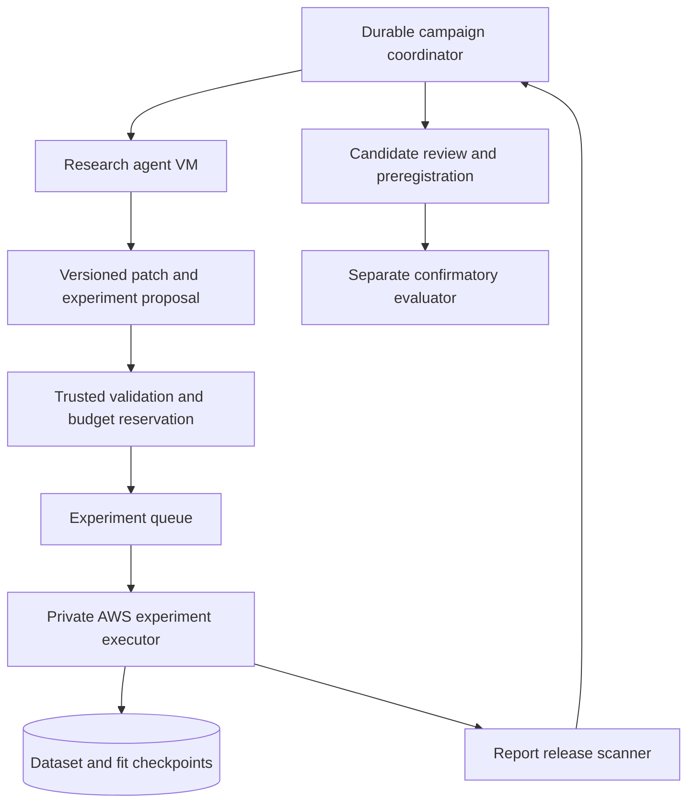

# Durable autonomous research for Sepsis

Sepsis source reviewed at `9ffe998`; the isolated Forge integration branch is
[`codex/sepsis-hybrid-research`](https://github.com/VirSanghavi/forge/tree/codex/sepsis-hybrid-research).

The intended system is persistent research agents with isolated execution environments:
they read the evidence, propose experiments, edit code, run bounded jobs, interpret the
results, and resume after interruption. A durable actor can own that process, but its
VM is replaceable. Persist the research state independently of the VM.

Recommendation after reviewing the user's existing Forge system: reuse Forge for durable
coordination, research agents and sandbox execution, and connect it to Sepsis through an
explicit experiment/evaluator adapter. Reuse the Sepsis Lab's scientific controls and
MIMIC's existing data, checkpoints and trust protocol. Start with one research worker and
one heavy experiment at a time. Use autonomous research to discover additional signal;
more agents or longer hyperparameter searches do not themselves establish a score gain.

## Evidence available and missing

The checked-in `demo_report.json` is a 99-subject integration fixture. After AWS
login was restored, the completed private AWS report passed the existing release scanner
and its aggregate projection was inspected. The best physiology-only development AUROC
was 0.8300 (`distill_P`); the process-of-care tier scored 0.8563 (`stack_S`). Temporal
validation scored 0.8169. These are distinct evaluation settings, not interchangeable
headline scores. The clock-matched six-hour scores were 0.7760 for `stack_S` and 0.7882
for `stack_P`, so improving overall tier-S AUROC alone would not establish earlier warning.

The user's own AutoPost-training copy had no configured research-model key or running
research-role service. The shared Forge copy has research-role configuration, but a
bounded synthetic provider call returned HTTP 401. Its hosted reasoning agents remain
unverified. Work is isolated on the separate branch; shared main and agent credentials
were left intact.

MIMIC-IV-Note access was confirmed and verified radiology ingestion was started on the
existing encrypted AWS worker. A separate offline local-transformer/GBM pilot is queued
behind successful file-hash verification, with 500 hash-selected development subjects,
original subject folds, nested blend selection, resumable private outer-fold receipts
and a shared 30-hour deadline. The original completed Sepsis environment and report are
retained. No new clinical score or improvement is claimed before the pilot completes;
a pilot gain would still require a matched full-cohort champion comparison.

The recorded AWS observations are also useful:

| Observed in code or documentation | Implication |
| --- | --- |
| `mimic/run.py`: 32 tuning trials moved development AUROC 0.8131 → 0.8163; the best of the first eight reached 0.8153 | The remaining 24 trials bought 0.0010 on the tuning validation setting. Prioritize new information and failure analysis over a larger search. These are selected development scores, not final held-out scores. |
| `docs/PHYSIONET.md`: first full run on 2 vCPU, 8 GB RAM, 24 GB swap; memory reached 10.1 GB versus 7.3 planned | Several heavy agent jobs on this host would compete for the same constrained resources. |
| `mimic/plan.py`: planner can reduce negative retention or remove stages to fit time and RAM | Inspect the report's actual chosen plan before blaming model quality. A richer run may help, but its score benefit must be measured. |
| `docs/NOTES.md` and `ml/notes/`: local note readers, timing rules, numeric feature generation and caching exist | The next task is a grid/ledger integration and evaluation, not building note infrastructure from scratch. Access is now confirmed; the isolated Forge branch adds a causal radiology-to-grid pilot and real local LoRA training. |

Relevant sources: [AWS run findings](PHYSIONET.md), [scales and modelling harness](../backend/ml/mimic/run.py),
[clinical text status](NOTES.md). Older README/roadmap statements that no credentialed run
has occurred or that no note extractor exists lag these newer files.

## What the repository already provides

| Component | Reuse | Missing for autonomous VM-backed agents |
| --- | --- | --- |
| `backend/aegis/lab.py` | Proposal, critic, veto, alpha budget, candidate and replication protocol | Current default proposers sample predefined changes; they do not investigate arbitrary code or papers. |
| `backend/aegis/lab_runner.py` | Multi-round campaigns and proposer feedback | Durable execution, worker allocation, tool execution and crash recovery for a campaign. Its current detector/policy adjudicators target the existing CinC detector workflow, not a general MIMIC candidate API. |
| `backend/aegis/lab_registry.py` | Canonical-change deduplication and hash-chained history | A single authoritative writer and transactional reservations across concurrent/retried submissions. |
| `backend/ml/physionet/pipeline.py` | Stages, input fingerprints, one-heavy-job lock, private logs and aggregate-report release scanner | An asynchronous submit/status/cancel contract that a coordinator can supervise. |
| `backend/ml/mimic/checkpoint.py` | Completed booster/twin fit reuse, keyed by inputs and code | Cross-host checkpoint availability if a worker VM is replaced. Current recovery depends on retaining the checkpoint disk. |
| `backend/ml/mimic/progress.py` and `plan.py` | Progress, measured speed, RAM/time planning | Fleet admission control and campaign-wide compute accounting. |
| `backend/ml/mimic/trust.py` | MIMIC code fingerprints, preregistration, power checks and controlled lock access | A trusted service boundary: agents must not obtain the lock by importing the module or changing its code. |

Lab and MIMIC trust protocols should be connected through an explicit adapter. Calling
`make lab-run-full` does not turn the MIMIC pipeline into an autonomous research system.

## Proposed architecture

**Campaign state.** One authoritative record owns the objective, evidence references,
proposal history, model/tool-call references, remaining compute budget, alpha accounting,
job IDs and artifact digests. Save each tool result before choosing the next action.
Store code, patches and released reports durably; keep private data and private logs out
of agent memory. Agent identity can survive several VM lifetimes.

**Research VM.** Each active worker gets its own checkout, environment, scratch disk and
resource limit. It can read code, public papers, invented/open-demo fixtures and released
aggregate reports. It produces a patch and a structured experiment manifest. It does not
receive the credentialed lake, PhysioNet credentials or locked outcomes. Cloud VMs provide
the desired per-agent isolation; a Git worktree alone is not a VM boundary.

**Experiment executor.** A private worker runs approved candidate code against development
data with an immutable evaluation harness. It retains the existing local checkpoint and
progress machinery. Run candidate code without network access or cloud credentials, with
restricted mounts; release only scanned aggregates. Scanner checks alone are insufficient
if arbitrary candidate code can access credentials or write unrestricted logs. The trusted
harness controls splits, targets, metrics and audits, and remains outside the writable
candidate checkout.

**Independent evaluation.** Adapt the Lab's review/replication ideas to MIMIC's subject
splits and `trust` protocol. Development exploration and confirmatory scoring are distinct
operations. The PhysioNet pipeline deliberately stops before preregistration/lock access;
retain that boundary. Agents may prepare a candidate and its evidence without silently
spending the MIMIC lock or promoting a model.

### Execution contract and recovery

The manifest should contain the hypothesis, rationale, expected direction, input tier,
comparator, cohort/label definition, primary metric, ablations, source commit and patch
digest, dataset/feature versions, seeds, environment digest and resource ceilings.

Use an immutable experiment ID derived from that manifest. Separate infrastructure
retries from scientific revisions: retrying an identical job does not create a new
hypothesis or spend alpha again; changing the manifest creates a new experiment.

Persist transitions such as `proposed → reviewed → queued → running → scanned → evaluated`.
Reserve budgets atomically before dispatch. For paid/model/tool side effects, use stable
request IDs where supported; durability alone does not make an external operation exactly
once. A restart should reconcile existing jobs before starting replacements.

Workers report heartbeats, last completed fit and artifact digests. A stale worker's
lease expires; fence its old attempt before a replacement writes results. On replacement,
reattach retained experiment storage or restore checkpoints, then let the existing
checkpoint code resume. Do not use an actor method as a blocking 30-hour training call:
submit a job, persist its handle, and wait through durable polling/events.

Keep the lake's exclusive lock and one heavy training slot for the initial deployment.
Add multiple heavy slots only when RAM, CPU and data isolation are provisioned for them.
Persist campaign budgets across restarts and worker identities; workers cannot each get
a fresh statistical budget. Record failures and nulls alongside successful experiments.

## Runtime choice

The initial runtime comparison below preceded discovery of the user's Forge system.
After reviewing Forge source, reuse it first; there is no established need to add a
second durable runtime. These are architectural options, not installed Sepsis
integrations. No runtime was benchmarked here.

| Option | Fit for this repository | Decision |
| --- | --- | --- |
| Existing Forge plus a Sepsis experiment adapter | Already implements durable actors, research roles, sandboxes, artifact records and governance. Its LLM-specific contracts need a Sepsis adapter. | Preferred path after source review; see the Forge assessment below. |
| Python durable workflow service, e.g. Restate, plus EC2 research/executor workers | Keeps the Python modelling stack and current AWS data location. Workflow owns state and job handles; EC2 owns execution. Restate supports keyed state and workflows, but is not a VM provisioner. | An alternative if Forge cannot meet the required contract. Keep its own state on durable storage with tested recovery. |
| Rivet Agents plus a sandbox adapter | Closely matches an agent with persistent conversation, tools and an optional shell sandbox. Adds an agent/control-plane integration and requires checking the sandbox's location and data boundary. | Worth a prototype if an integrated agent platform matters more than minimizing new infrastructure. |
| Amazon Bedrock AgentCore Runtime | Offers dedicated microVM sessions; microVM lifecycles are bounded and state needs external persistence/configured storage. | AWS-native option for the reasoning/coding worker. Keep long training jobs separate from a microVM session's lifetime. |
| TerseAI/durable-actors | Python actors provide persisted fields, SQLite and alarms. Current supported production self-hosting documentation targets GCP/GKE with GCS and PostgreSQL. | Useful primitive, but introduces a hosting-platform change for this AWS deployment. It is not necessary to adopt this specific library to achieve durable agents. |

Sources: [Restate Python services/workflows](https://docs.restate.dev/develop/python/services),
[durable steps and replay](https://docs.restate.dev/develop/python/durable-steps),
[Rivet Agents and sandboxes](https://rivet.dev/agents/docs/),
[AgentCore session lifecycle](https://docs.aws.amazon.com/bedrock-agentcore/latest/devguide/runtime-sessions.html),
[Terse Python guide](https://github.com/TerseAI/durable-actors/blob/main/docs/reference/python-guide.md),
[Terse hosting requirements](https://github.com/TerseAI/durable-actors/blob/main/docs/self-hosting.md).

### Forge source assessment

Reviewed private repository `VirSanghavi/forge` at
`f19c46dd0a9e9df1911007690b4f0979a12f2538` through the authenticated GitHub CLI and
an isolated read-only review checkout initially. The subsequent implementation uses
a separate clone and branch, with 102 focused tests passing. It adds an opt-in experiment
lane without merging into shared main or changing its existing campaign defaults.

Forge is sufficient as the coordination foundation. Source inspection confirms:

- `services/actors/src/actors.py`: persisted campaign, experiment, governance, artifact
  and team state, plus Hephaestus's SQLite-backed turns, actions and missions.
- `services/core/agents.py` and `workbench.py`: model-backed roles and bounded delegation;
  per-role Freestyle VMs with a `run_python` evidence tool, pauses and cleanup. Subagents
  share their parent's role VM in separate folders. These are bounded evidence-analysis
  environments; the core role toolset does not yet implement a Sepsis repository-edit,
  literature-search and AWS-experiment tool chain.
- `services/harness/`: dependency graphs, persisted task state, verified artifact
  handoffs, declared safe retries and SuperServe execution.
- `packages/terse-actors/` and `services/orchestrator/`: a separate TypeScript profile
  with signed-role authority, fenced worker leases, durable outbox and reconciliation.
  Do not assume this profile's controls automatically protect the root Python UI path.
- `tests/test_crash_recovery.py`: tests that kill the native Terse runtime before,
  during and after mutations. This is stronger evidence than a durability claim alone,
  but it does not establish recovery of arbitrary training or the whole campaign loop.

The remaining integration is concrete:

1. Add a Sepsis experiment kind and result schema. `CampaignConfig` currently restricts
   strategies to LLM SFT/distillation/GRPO/DPO and scores answer-oriented task packs.
   Preserve Sepsis subject-grouped folds, early-warning labels, AUROC, fixed-alert-budget
   detection, bootstrap comparisons and its locked evaluation; a generic CSV task-pack
   upload uses different splitting/scoring semantics.
2. Add trusted AWS submit/status/cancel and scanned-report import tools. Keep MIMIC data
   and private logs on the existing AWS executor. Core-agent `run_python` returns stdout
   directly to the model; only permitted code/demo/aggregate evidence may enter that VM.
3. Persist and reconcile each experiment boundary. `services/harness/campaign.py` wraps
   the entire command-center campaign as one task, without safe retries. Its documented
   behavior is to stop and preserve evidence after interruption, not automatically
   resume the internal research loop. Attach the Sepsis fit-checkpoint mechanism and
   stable job IDs rather than retrying the whole campaign.
4. Change duration/budget contracts for long AWS jobs: root `CampaignConfig.max_seconds`
   is capped at 14,400 seconds (4 hours), while the existing AWS budget defaults to
   30 hours. Supervise an external job asynchronously; merely increasing a VM lifetime
   does not supply durable recovery. Coordinate heavy slots across campaigns/hosts.
5. Bind Forge governance to the existing MIMIC evaluator and lock authority. Keep final
   scoring separately permissioned and freeze the code, data, environment and reader
   versions before confirmation.

Begin with Forge reading one released AWS report and proposing one physiology ablation.
The acceptance test is a demo-backed Sepsis experiment that survives coordinator/worker
interruption without duplicated jobs, budget charges or lock access. Only then widen
the research loop.

Sources: [Forge agents](https://github.com/VirSanghavi/forge/blob/f19c46dd0a9e9df1911007690b4f0979a12f2538/docs/agents.md),
[workflow limits](https://github.com/VirSanghavi/forge/blob/f19c46dd0a9e9df1911007690b4f0979a12f2538/docs/workflow-harness.md),
[campaign contracts](https://github.com/VirSanghavi/forge/blob/f19c46dd0a9e9df1911007690b4f0979a12f2538/services/core/contracts.py),
[command-center boundaries](https://github.com/VirSanghavi/forge/blob/f19c46dd0a9e9df1911007690b4f0979a12f2538/docs/command-center.md).

## Research most likely to improve the AWS results

### First establish the actual baseline

After restoring AWS access, inspect only the released aggregate report and numbers-only
status. Record the source revision, dataset fingerprint, plan and enabled stages, retained
negative fraction, best models by tier, admission failures, paired comparisons, temporal
validation, care-process reliance, clock-matched horizons and alert frontier.

`tuning.best_auroc` is a selected tuning-fold score. Use `headline`, `models`, `comparisons`
and `crossexam` to identify the final development result and what it means. A patient-max
AUROC, an all-stays score and an early-warning hourly score answer different questions;
the report's `ideal_circumstances` is not automatically the primary result.

### Ranked experiments

| Priority | Investigation | Metric and decision |
| --- | --- | --- |
| 1 | If the AWS plan dropped stages or retained only a fraction of negatives, compare that plan with a richer development run on an appropriately sized executor. Pin all other choices. | Same-subject paired primary AUROC and alert frontier. This tests a resource-limited baseline; more RAM itself is not a scientific intervention. |
| 2 | Measure which existing physiology groups add information: bedside exam, within-hour extremes, history, labs and signatures. The costly information ledger is disabled in the full preset. Use a small, declared ablation set first. | Physiology-only early-warning AUROC, hour-matched horizons, temporal/subgroup performance and process-transplant robustness. Only pursue a feature family after its failure mode is identified. |
| 3 | Wire `ml/notes` numeric outputs into extraction and the ledger, then compare no notes, keywords, and a local encoder on identical development subjects. Confirm dataset access first. | A **tier-S** improvement. Current rules intentionally keep notes out of tier P, so this cannot be claimed as a physiology-only primary-score gain. Use `storetime`, exclude current-admission discharge summaries and separate indication from findings. |
| 4 | Investigate alert-budget failures using the existing frontier and clinician-conditional/horizon analyses. | Detection at a fixed alert budget, with threshold selection on development/calibration data. Calibration can change operating behavior; a monotone calibration cannot improve AUROC. Prior smoothing/threshold nulls lower the priority of broad policy searches. |
| 5 | Build external/temporal validation and eventually an eICU extractor. | Transfer robustness on a separately defined cohort. Valuable for generalization, but not a guaranteed increase in MIMIC AUROC. |

The note integration also needs provenance work: `trust.HARNESS_GLOBS` currently excludes
`backend/ml/notes/*.py`. Include note-reader code and reader/model fingerprints in the
evaluation manifest and feature/checkpoint invalidation before comparing readers.

Avoid launching another unrestricted architecture or tuning sweep first. The recorded
AWS tuning spread is small, and `docs/GENESIS.md`/`docs/MIMIC.md` already contain many
model-side nulls. No numerical improvement is predicted without the completed report
and paired experiments.

## Smallest useful implementation

1. Add an asynchronous experiment submit/status/cancel adapter from Forge to the existing
   pipeline, plus a manifest schema and single-writer budget/job state. Preserve private
   logs and the report scanner. Build the MIMIC evaluator adapter explicitly.
2. Extend one Forge research workflow with the required tools and one isolated coding VM. Give it a finite task:
   inspect the released AWS report, identify one failure, implement one ablation, run the
   open-demo production path, submit one development experiment, and write a result.
3. Prove recovery before scaling: kill the coordinator and worker separately; confirm
   completed fits remain reusable, jobs are not duplicated, budgets are not reset and
   reports/registrations are not published twice. Verify the worker cannot edit the
   evaluator or access the lock. Then add a second worker for an independent research
   direction while keeping heavy training serialized until capacity permits more.

Initial success is a campaign that survives interruption and produces reproducible,
audited experimental evidence. A score improvement is a separate measured outcome.

## Local text model, second generation

The Forge pilot's text model is stock SmolLM2-135M-Instruct (no architecture change),
fine-tuned with LoRA rank 8 for 128 steps at batch 8 on CPU and blended into the tier-S
GBM by one scalar weight. Reading its configuration against the private bundle's
aggregate shape (30,047 development rows, 480 subjects, **1,310 distinct note contexts**,
a third of rows with no note) showed why it could not move the hybrid:

- 1,024 sampled rows per fit are mostly repeats of the same signed report.
- `hourly_text` keeps the last 4,000 characters oldest-note-first and the tokenizer cuts
  from the right, so a 256-token window kept the older note and dropped the newest one.
- A randomly initialised last-token head trained for 128 steps; fusion was one scalar.

Branch [`claude/sepsis-text-model-v2`](https://github.com/VirSanghavi/forge/tree/claude/sepsis-text-model-v2)
adds an opt-in replacement behind the same interface: newest impressions first and
left truncation, training over unique contexts with summed design weights, frozen
pooled SmolLM2 embeddings (label-free, computed once per run) with a cross-validated
head and an optional TF-IDF channel, larger frozen SmolLM2 encoders (360M, 1.7B in
bfloat16), an opt-in stacked GBM that takes the inner out-of-fold text logit as a
feature, and a leakage-safe domain-pretraining script for a future GPU worker. Its
design and guards are in the branch's `docs/sepsis-text-model.md`.

### Ladder result (2026-11-08, exploratory)

The four-step ladder ran on the private worker on the same bundle and folds. The table
compares on the pilot's completed outer folds 0-2 (17,485 rows, 240 subjects), with a
paired patient bootstrap (1,000 draws); only these aggregates left the lake.

| Configuration | Text alone, AUROC | Text alone vs v1 | Stacked vs GBM (0.799) |
|---|---|---|---|
| v1 (pilot) | 0.467 | | |
| 135M | 0.494 | +0.027 [−0.076, +0.131] | −0.003 [−0.013, +0.009] |
| 135M + lexical | 0.526 | +0.060 [−0.042, +0.162] | −0.001 [−0.009, +0.008] |
| 360M + lexical | 0.524 | +0.057 [−0.042, +0.169] | −0.003 [−0.013, +0.010] |
| 1.7B (bf16) + lexical | 0.517 | +0.050 [−0.053, +0.166] | −0.005 [−0.015, +0.006] |

No configuration met the bar (a stacked interval above zero). The text arm stays near
chance, and a 13-fold larger encoder changes nothing, so capacity is not the limit.

The receipts pointed at a selection fault. In every run the head's internal CV over
training contexts reported AUROC 0.61-0.71 and chose the weakest regularisation on the
grid (C=10) in every fold, while held-out subjects scored about 0.52-0.55. The CV split
contexts, not subjects; consecutive hourly contexts of one stay share notes, so the
split rewarded memorising patients. On a planted cohort whose only signal is patient
identity, that selector scores 0.997. Forge `2b37bb1` makes it subject-grouped (the
same cohort then scores chance), and `9069b54` makes LoRA on a 1.7B backbone fit the
7.6 GB worker (gradient checkpointing, float32 adapters on a bf16 backbone). A rerun of
the 135M + lexical configuration with the fix, and a timing probe of 1.7B LoRA on
synthetic text, are queued.
