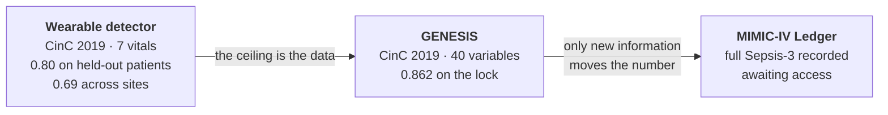
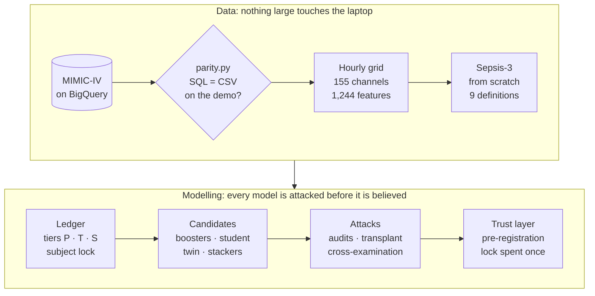

# Findings

The research record behind AegisOS: what was measured, strongest first, then the published
nulls, the three research lines and the MIMIC-IV chapter. Each finding links to the report
that holds the method, the numbers and the caveats. (Moved here from the top-level README
when the README became the system's front door; the text is unchanged.)

## The findings

These are the thirteen most important results, strongest first. Each links to the report
that holds the method, the numbers and the caveats.

### 1 · The first detector was an illusion

The original hand-tuned detector was finally measured on real ICU patients. It scored
**AUROC ≈ 0.64**, and its probabilities were essentially uncalibrated. Its perfect demo had
come from tuning the simulator and the detector together. Every detector since has been
trained and validated on real labelled patients, with patient-grouped splits.
→ [`backend/ml/README.md`](../backend/ml/README.md)

### 2 · The ceiling is the data, not the architecture

No new architecture or representation raised discrimination on hourly vitals:
- richer temporal features;
- a causal MiniRocket;
- Forest-VSA;
- quantum HDC;
- a dilated TCN and a Mamba-2 state-space model.

A recursive hyperparameter search over the wearable ensemble accepted **0 of 16** mutations.
The one thing that moved the number was information. A properly regularised booster reading
all 40 CinC variables took the locked test set from **0.805 to 0.862** (+0.057, CI +0.046 to
+0.068). The purpose-built GENESIS architecture beat a tuned booster on the development
folds, then **failed to replicate on the lock**. The simpler model is the recommendation.
→ [`docs/GENESIS.md`](GENESIS.md) · [`docs/FRONTIER_REPORT.md`](FRONTIER_REPORT.md)

### 3 · More patients moved the detector, and shipping it exposed four silent defects

The shipped detector had been trained on 5,996 of CinC's 40,335 patients. A registered study
refitted it on all of them: pooled AUROC **+0.030** (CI +0.026 to +0.033). Shipping that took
two registered refusals and a third registration. The refits ranked far better but tripped
over the final calibration step. Isotonic regression is a **22-step staircase**: hours on a
step tie, so the model's ranking inside each step is discarded. The shipped model had no
operating point between a 5% and a 51% false-alarm rate. Centred isotonic regression keeps
the calibration without the steps (registered: AUROC +0.002, ECE unchanged).

The refit read through it passed every gate on 6,852 patients neither model had seen:
- AUROC **0.743 → 0.800**;
- utility at each model's own threshold **+0.35 → +0.40**;
- septic patients caught inside a 15% alarm budget **41% → 55%**.

Shipping surfaced four defects that measuring alone never had:
- a detector identity that ignored the training set, so the old model's uncertainty bands
  would have been accepted for the new one;
- an audit that would have scored the new model on its own training patients;
- a budget rule, shared by four modules, that alarmed every tied patient, so its "5% budget"
  alarmed **51%**;
- per-patient metrics that scanned every row once per patient (286 s → 0.01 s).

All four are fixed and guarded by checks seen to fail.
→ [`docs/DATA_LEVER.md`](DATA_LEVER.md) · [`docs/CALIBRATION_RESOLUTION.md`](CALIBRATION_RESOLUTION.md)

### 4 · About 0.05 of every CinC 2019 AUROC is a clock

Never-septic records stop near 60 hours, while septic records run to 336. So the ICU clock
**alone** scores **0.636**. Every GENESIS number is therefore paired with an
*hour-matched* AUROC, under which the clock is worth exactly 0.500.

The learning curve's asymptote, **0.887**, puts 0.90 out of reach on CinC with this label.
Sepsis-3 has two halves, and the half that sets the onset clock (cultures and antibiotics)
is not in CinC at all. That is why the next step is MIMIC-IV.
→ [`docs/GENESIS.md`](GENESIS.md)

### 5 · On hourly vitals, sepsis detection is patient classification, not event timing

Pooled AUROC averages two questions:
- *Which patients* become septic?
- *Which hours* of a septic stay come before onset?

The experiment labelled every hour of a septic stay positive during training. That raised
detection at a 5% alarm budget by **48%** (0.274 → 0.406). The gain was significant in
**25 of 25** density × budget cells, and it transferred across hospitals in both directions.

Scattering the extra positives at **random** beat placing them before onset, and AUROC did
not move. This lever was invisible to a project that had been reading AUROC.
→ [`docs/SUPERVISION_DENSITY.md`](SUPERVISION_DENSITY.md)

### 6 · Median lead time does not measure early warning

A random score produced the same median lead time as the shipped detector at every matched
detection rate. That retracted every lead time this project had published (26 to 40 hours).
The replacement costs nothing: report lead time against a shuffled-score null at a matched
detection rate. → [`docs/LEAD_TIME_NULL.md`](LEAD_TIME_NULL.md)

### 7 · We trained on the wrong target, and stacking pays for disagreement

The challenge label turns positive 6 hours before onset, but the official utility also pays
for alarms 6–12 hours earlier. So **3,419 patient-hours**, carrying ~19% of the
positive-side utility, had been trained as negatives.

Re-aiming every ensemble member at the utility was worth nothing: the re-aimed ensemble
ranked hours almost exactly as the original did (rank correlation 0.965). What did pay was one utility-aimed XGBoost that *disagrees* with the stack (rank correlation
0.679): it raised AUPRC by **9.4%**. → [`docs/FRONTIER_REPORT.md`](FRONTIER_REPORT.md)

### 8 · The alarm threshold was a guess, and it sat on a cliff

The shipped threshold, 0.12, was a constant nobody had derived. It sat at the **98.3rd
percentile** of the detector's own output, where a small calibration drift would have
silently switched the alarm off. Deriving the threshold from out-of-fold predictions bought
**+14% utility and +10 points of detection** at an identical AUROC. When discrimination is at
its ceiling, the wins are in decisions. → [`backend/ml/README.md`](../backend/ml/README.md)

### 9 · Cross-hospital "decision collapse" was our own bug, and label-free adaptation makes it worse

Across hospitals, utility fell 54% while AUROC fell 13%. Much of that gap was
threshold/fit coupling, not hospital shift.

Label-free prior correction made things significantly worse in both directions. EM
estimated a **29×** prevalence shift against a true **1.99×**. The two hospitals differ in
their patients' measurements (a domain classifier separates them at AUC 0.90), not in their
label rates. → [`docs/TRANSFER.md`](TRANSFER.md)

### 10 · Uncertainty guarantees do not travel

Within a hospital, conformal abstention delivers **93.5%** coverage at 94% requested. Now
calibrate it at one hospital and serve it at the other: septic-hour coverage collapses from
**0.929 to 0.739**, while the layer *halves* its abstention rate. It grows confident exactly
where it should not. → [`docs/CONFORMAL.md`](CONFORMAL.md)

### 11 · One threshold is not one burden

Discrimination is flat across age and sex, but the alarm burden is not. At the deployed
threshold:
- patients over 80 absorb **+6.3 points** more false alarms than under-45s;
- men absorb **+4.9** more than women.

Both gaps survive Bonferroni correction. Per-group thresholds were refused: they would
launder the disparity into the threshold rather than fix it. These gaps were measured on the
previous detector and its threshold; the audit has not yet been re-run on the refit.
→ [`docs/SUBGROUP_AUDIT.md`](SUBGROUP_AUDIT.md)

### 12 · The MIMIC-IV harness caught leaks in our own pipeline before any data arrived

On the open demo it found three:
- **Two covert channels.** Verbal GCS predicts mechanical ventilation at AUROC **0.962**,
  because the intubation recode turns a score of 0 into a record of the breathing tube. FiO2,
  a ventilator setting, predicts it at **0.949**.
- **A counterfactual design that smuggled the care schedule back in.** A schedule-only world
  scored **0.731** "from values". With state-matched successors it falls to **0.542**.
- **A standard cross-fitting recipe for distillation that leaks labels through the
  teacher.** It produced **+0.048** of apparent gain.

All three are fixed and guarded by checks that were seen to fail.
→ [`docs/MIMIC.md`](MIMIC.md)

### 13 · 1,000 beds on one core, by removing work rather than adding hardware

The load harness drives the real cohort tick with no mocks: device bus, memory fabric,
fusion, learner, HDC memory, resonance gate and the Z3-verified scheduler. It first held
**250 beds** inside the 600 ms tick; profiling showed Z3 was not the bottleneck, as planned
for, and that hyperdimensional memory was. A second pass found that 88% of each tick
recomputed an unchanged hourly input, and that every bed's clock was phase-locked, so the
whole ward recomputed on the same tick. Exact memoisation, staggered clocks, a lookup-table
encoder and a one-script scheduler proof now hold **1,000 beds at p99 267 ms**
(400 beds: 664 → 106 ms). Every change is bit-identical to the code it replaced, held there
by a suite of 36 checks that must catch planted defects. → [`docs/SCALE.md`](SCALE.md)

### Published nulls

A null reported in full is a result. These are the hypotheses this project tested and lost.

| Hypothesis | What happened | Report |
|:--|:--|:--|
| The *speed* of autonomic recovery (τ) predicts circulatory decompensation | Failed its pre-registered bar. Retested on VitalDB at 6× the cohort with the intervention confound removed, with the same answer | [RECOVERY_NULL](RECOVERY_NULL.md) |
| Blood gene expression separates infection from sterile inflammation across cohorts and platforms | Mean transfer AUROC 0.727 (CI 0.636–0.810) against a 0.75 bar. **Bar missed**, scored once against a committed pre-registration | [HOST_RESPONSE_NULL](HOST_RESPONSE_NULL.md) |
| Organ-system uncoupling carries sepsis signal at hourly resolution | Falsified with a matched-pair surrogate design | [SUPERVISION_DENSITY](SUPERVISION_DENSITY.md) |
| A patient-supervised TCN added to the stack helps | Refused: its significant AUROC gain (+0.0038) exists only at the boundary blend weight. Its reported detection loss used a since-corrected budget rule | [SEQUENCE_PATIENT_NULL](SEQUENCE_PATIENT_NULL.md) |
| Quantum hyperdimensional computing beats classical models on tabular vitals | No. The encoded states concentrate, and the quantum kernel cannot discriminate | [backend/ml](../backend/ml/README.md) |
| Random-convolution or tree-topology representations add signal | MiniRocket +0.0012 (n.s.). Forest-VSA's own lossless ceiling loses to its donor | [backend/ml](../backend/ml/README.md) |
| A new hospital can re-derive its operating point without labels | Significantly harmful in both directions | [TRANSFER](TRANSFER.md) |
| Median lead time is evidence of early warning | Retracted | [LEAD_TIME_NULL](LEAD_TIME_NULL.md) |
| HDC case retrieval, added as a disagreeing member, raises the detector's AUROC | Registered null. The best HDC model yet (0.726 alone, Spearman 0.60 with the stack) adds nothing to the best detector | [HDC_MEMBER_NULL](HDC_MEMBER_NULL.md) |

---


---

## The three research lines

Each line inherited the previous one's lesson.



### 1 · The wearable detector (`backend/ml/`)

The production detector reads the seven vitals a wearable could stream. The research
infrastructure around it:

| Component | What it does |
|:--|:--|
| `eval/bench.py` | Fixed, patient-grouped folds for every candidate, with differences bootstrapped over **patients**. Hours within a stay are too correlated for a row bootstrap |
| `eval/utility.py` | The official CinC utility, vectorised (it reproduces the reference to 3e-16) and turned into a training target |
| `models/stacked.py` | The production ensemble, with a per-member objective and a choice of calibrator |
| `models/calibration.py` | Isotonic, Platt, and centred isotonic regression (the same calibration without the staircase) |
| `operating_point.py` | Alarm thresholds derived from out-of-fold predictions, never guessed |
| `conformal.py` · `shift.py` | Mondrian conformal abstention, and label-free diagnosis of label, covariate and concept shift |
| `falsify.py` · `mutations.py` | The falsification engine: mutate a scientific invariant and require that a **named** check fails |
| `fitid.py` | Fit fingerprints: a quantity is valid only against the fit it came from, and cross-fit reads are refused. The detector key carries a training-set digest and its calibrator |
| `selfimprove.py` | A self-adaptive evolution strategy over the ensemble, gated on locked patients it never searched |

### 2 · GENESIS, the all-variable line (`backend/ml/genesis/`)

GENESIS asked how far hourly early warning goes when the model may read all 40 CinC
variables. It includes:
- a cohort-wide raw store and **510 strictly causal features**, vectorised (6.6 s for 1.55 M
  rows);
- a **20% locked test set** (8,067 patients) split off before any design work and scored
  once;
- the pooled = between + within decomposition, and the hour-matched AUROC;
- the Genesis Network: the Sepsis-3 label factorised into *who* × *when* × *direct* experts,
  plus a causal GRU with a Sepsis-3 AND-gate head and a physiological world model.

Its final lesson carried forward: the tuned booster's score was *sufficient* for its inputs.
Adding every feature back on top made it worse, so only new information could move the
number. → [`docs/GENESIS.md`](GENESIS.md)

### 3 · The MIMIC-IV Ledger (`backend/ml/mimic/`)

See the next section.

---

## MIMIC-IV: the next chapter

CinC 2019 is missing two kinds of information:
- three of SOFA's six organ systems (Glasgow Coma Scale, urine output, vasopressor doses);
- the suspected-infection record (cultures and antibiotics) that starts the Sepsis-3 clock.

MIMIC-IV records all of it. The whole pipeline is **built and verified on the open
100-patient demo**, and waits only on credentialed access.



**Nothing large ever lands on the laptop.** BigQuery bins every event to the hour on
Google's servers, and results are placed into the grid page by page. The planner prices a
full-MIMIC-sized run before a single feature is built: about 2.4 M rows, 6.1 GB of features,
7.4 GB of peak RAM and ~9.3 hours, from a per-fit constant measured with the full-run settings
on real data. If nothing fits the machine, it refuses and names the constraint. Every fit's
data ingestion is 2x faster than before, and heads that bin the same fold share one dataset
(25 of 73 fits skip it), with models byte-identical to the unshared ones.

**Every input declares what it knows.** The three tiers are:

| Tier | Reads | Question it answers |
|:--|:--|:--|
| **P** | Physiology only: vitals, labs, the bedside exam, arrival context | Can the patient's body be read before anyone acts? |
| **T** | P plus treatments: vasopressors, ventilation, fluids, sedation, dialysis | What does the care already given reveal? |
| **S** | T plus suspicion orders: cultures, antibiotics | How much is reading the clinicians' own suspicion? |

<details>
<summary><b>The harness</b> · five attacks every model must survive</summary>

<br/>

| Layer | The attack |
|:--|:--|
| **Admission audit** | Every fitted model is re-scored on patients whose future has been rewritten or truncated, and whose neighbours have been scrambled. A model whose past scores move is refused |
| **Information-flow audit** | Each physiology channel is asked to predict treatment state. At AUROC ≥ 0.90 it is a covert channel, and the strict tier drops it along with every composite built on it |
| **Care-Process Transplant** | Each patient is rebuilt on a random donor's measurement schedule with their own physiology. The AUROC a model loses is its *process reliance*: what it would lose at a hospital whose clinicians order differently. A Shapley split separates process from physiology |
| **Cross-examination** | Seven questions for every headline model: how much of the AUROC is only the Sepsis-3 formula (the definitional oracle)? Does it separate sepsis from sickness (infection-only and organ-only contrasts)? Does it beat the clinicians' own orders? Then clock-matched horizons, soft-label AUROC over nine definitions, subgroups (Wald test, Holm correction) and the alert frontier |
| **Trust layer** | A hash-chained ledger bound to a code fingerprint, and power-gated pre-registration that refuses a claim the lock cannot answer. Each claim is confirmed once, and the Ladder lock covers exploratory submissions (it cuts a boosting attack from +0.107 to +0.014) |

</details>

<details>
<summary><b>The temporal model</b> · Sepsis-3 Process Twin v2</summary>

<br/>

- **Two input streams**, values and the care process, joined through a learned gate.
- **Two regimes.** A record twin reads everything. A physiology twin is trained on
  transplanted patients, so it cannot read the schedule. Every alert is attributed between
  process and physiology.
- **Discrete-time hazards**: eight censoring-aware bins, instead of one fixed horizon.
- **An organ outlook** composed into the exact probability that the total SOFA rise
  reaches 2, the Sepsis-3 threshold.

</details>

<details>
<summary><b>The AUROC levers</b> · what the research round added, and why</summary>

<br/>

| Lever | Evidence | Built as |
|:--|:--|:--|
| **The bedside exam** | Mottling and capillary refill predict septic-shock mortality. Nurses chart them as *text*, so almost no model reads them | 12 ordinal channels from 27 charted items, keeping the worst finding of each hour |
| **Within-hour extremes** | 9.5% of hypotensive hours dip and recover before the hour's last reading | The hour's lowest MAP, SBP and SpO₂ and highest HR, respiratory rate and temperature. SOFA reads the lowest MAP |
| **Infection-source detail** | Suspicion is a class of orders, not one event | Culture specimen groups and antibiotic spectrum (tier S) |
| **Path signatures** | The CinC 2019 winner's technique | Exact level-2 signatures (quadratic variation, and Lévy areas for which stream moved first) from stay-local prefix sums |
| **Privileged-tier distillation** | Learning using privileged information | A physiology-only student learns from an orders-aware teacher, through training targets only. Pairwise-held-out teachers remove the +0.048 leak that ordinary cross-fitting creates |
| **Fitting it well** | Tuning was CinC's largest model-side gain | Dev-only tuning, a soft label over nine definitions, and a prior-centred stacker that starts at the product and learns only shrunken corrections |

The full research map, including what CinC already ruled out, is in
[`docs/MIMIC.md`](MIMIC.md) §7. The strongest lever not yet built is radiology reports
(+2.9% AUROC in the literature). They need the separately credentialed MIMIC-IV-Note module.

</details>

### Runbook for when access arrives

```bash
pip install google-cloud-bigquery db-dtypes
gcloud auth application-default login

# 1. The SQL must reproduce the CSV binning on the demo's 100 patients
python -m backend.ml.mimic.parity --project <gcp-project>

# 2. Extract once and see the plan this machine can afford
python -m backend.ml.mimic.run --source bigquery --project <gcp-project> --plan-only

# 3. Every stage on the development folds (the lock is never read)
python -m backend.ml.mimic.run --source bigquery --project <gcp-project> --scale full
```

Steps 4 and 5 are:
- **Before any locked number exists**, pre-register the claims (`trust.preregister`) and
  commit the chain.
- **Then** spend the lock once per claim (`trust.lock_scores`, `trust.confirm`).

**What to expect (expectations, not results):**
- **Physiology only, early warning, hourly** (the honest number): roughly **0.80–0.87**.
- **All information, every stay, hourly:** plausibly around **0.9**.

The report always prints its single highest number as `IDEAL CIRCUMSTANCES`, with the tier,
the setting and the pre-registered primary beside it.

---

