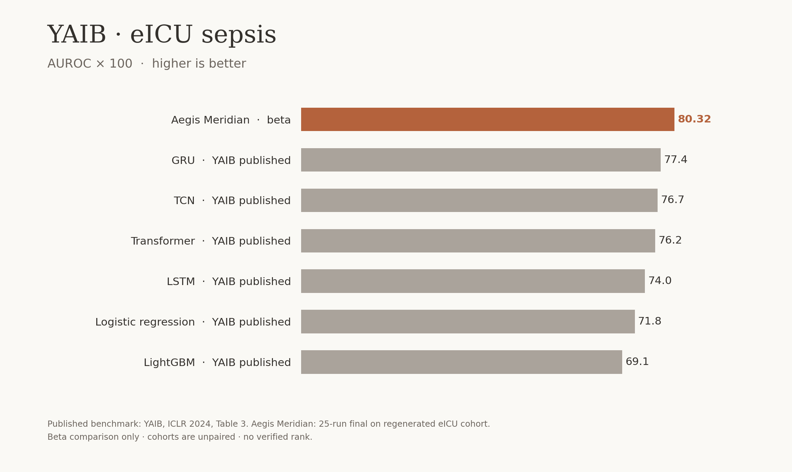

# YAIB eICU sepsis beta comparison

Values are AUROC × 100. YAIB's eICU sepsis values (GRU 77.4, TCN 76.7,
Transformer 76.2, LSTM 74.0, logistic regression 71.8, LightGBM 69.1) come from
[ICLR 2024 Table 3](https://proceedings.iclr.cc/paper_files/paper/2024/file/c26a89073d972f2e6643617b0f3a9e8a-Paper-Conference.pdf).
Aegis Meridian's plotted value is 100 × the final 25-run aggregate AUROC
0.8031774086445376, recorded on the credentialed worker at
`/srv/aegis/yaib-final-fd9dd6f/final.json`.

The paper's model names are algorithm classes. It reports no named systems such
as COMPOSER or InSight on this YAIB eICU sepsis task. The paper and Aegis used
cohorts generated at different times; this figure is an unpaired reference, not
a rank or evidence of superiority. The paired run uses YAIB's own code and our
regenerated cohort to compare identical test rows.
